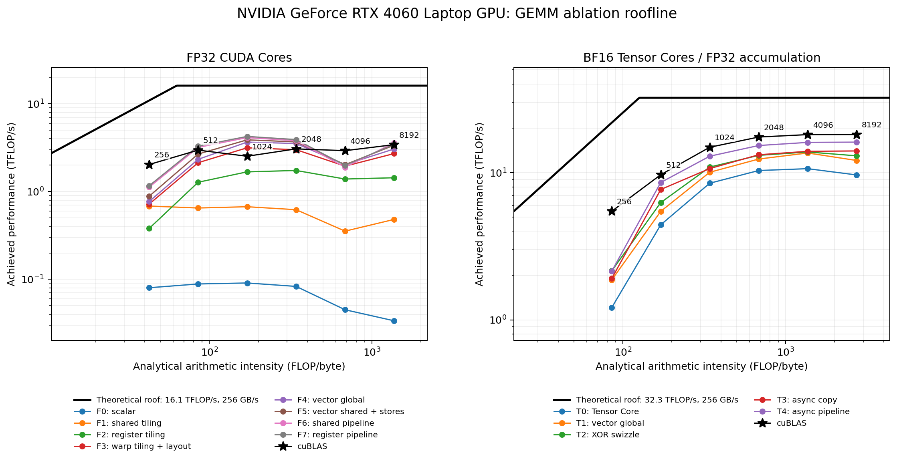
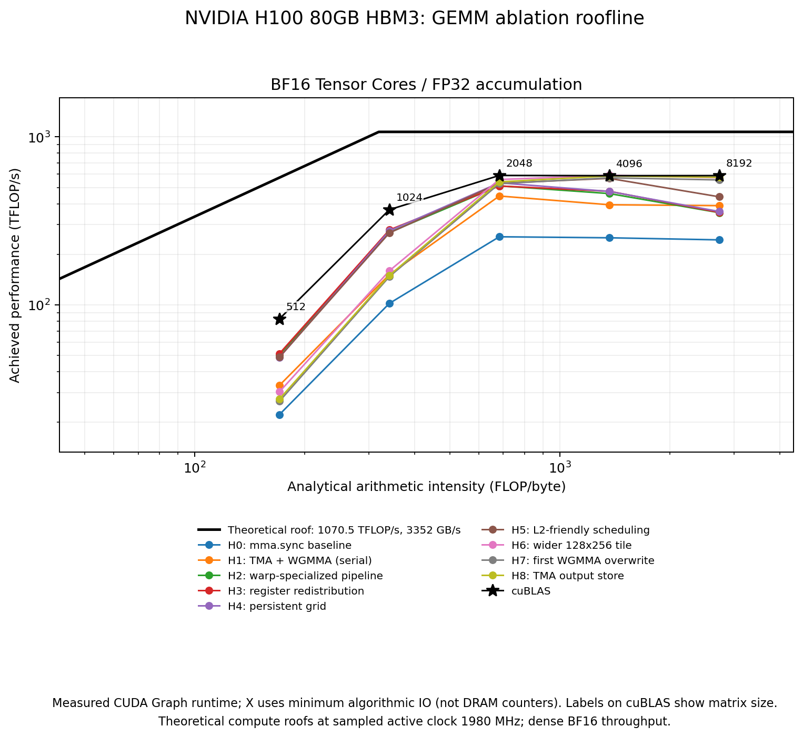
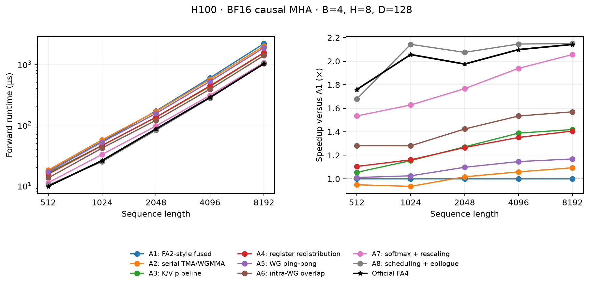

# gpu-kernels

Hand-written CUDA kernels benchmarked against established libraries. Times are in microseconds; **reference % = reference time / custom time × 100**. Results below are from the latest matching runs recorded in this project.

## GEMM — SM89 (RTX 4060 Laptop)

[`kernels/gemm/matmul/sm89.cu`](kernels/gemm/matmul/sm89.cu) implements FP32 CUDA-core and BF16 Tensor Core GEMM (TN layout).

| M=N=K | dtype | custom µs | cuBLAS µs | reference % |
| ---: | :--- | ---: | ---: | ---: |
| 2048 | FP32 | 2600.45 | 2546.98 | 97.9 |
| 2048 | BF16 | 755.92 | 644.02 | 85.2 |

- FP32: block/warp/thread tiling, register accumulation, `float4` loads, shared-memory double buffering.
- BF16: `mma.sync`, `ldmatrix`, XOR swizzling, two-stage `cp.async` buffering.

## GEMM — SM90 (H100 SXM)

[`kernels/gemm/matmul/sm90.cu`](kernels/gemm/matmul/sm90.cu) implements BF16 persistent WGMMA GEMM. These are the latest reported results for the current Kernel 10 version.

| M=N=K | custom µs | cuBLAS µs | reference % |
| ---: | ---: | ---: | ---: |
| 2048 | 30.53 | 27.59 | 90.4 |
| 4096 | 227.58 | 219.14 | 96.3 |
| 8192 | 1794.82 | 1807.82 | 100.7 |

- TMA loads/stores, WGMMA, three-stage shared-memory pipeline, persistent tile scheduling, shared-memory output epilogue.

## GEMM ablation: analytical rooflines

Each curve compares incremental kernel optimizations with cuBLAS. Throughput comes
from measured CUDA Graph runtimes; arithmetic intensity uses minimum algorithmic
IO, not measured DRAM traffic. The roofs use theoretical bandwidth and dense
compute throughput at the sampled active GPU clock. Matrix sizes label cuBLAS
points; these plots do not establish actual memory traffic or bottlenecks.

### SM89: RTX 4060 Laptop

FP32 stages F0-F7 and BF16 stages T0-T4 cover tiling, vectorized access, swizzling,
and asynchronous pipelines, with square matrices from 256 to 8192. Stage files
are in [`ablation/sm89_fp32/`](ablation/sm89_fp32/) and
[`ablation/sm89_bf16/`](ablation/sm89_bf16/).



### SM90: H100

BF16 stages H0-H8 cover TMA/WGMMA, warp specialization, register redistribution,
persistent scheduling, L2-friendly scheduling, wider tiles, accumulator overwrite,
and TMA output stores, with square matrices from 512 to 8192. Stage files are in
[`ablation/sm90_bf16/`](ablation/sm90_bf16/). Some transitions change tile size and
queue depth together; improvements are not necessarily monotonic.



## FlashAttention forward

[`kernels/attention/flash_attention/`](kernels/attention/flash_attention/) contains causal BF16, head-dimension-128 MHA/GQA/MQA kernels for SM89 and SM90. Tables show MHA only. Latest reported RTX 4060 run: `B=1, T=512, Hq=Hkv=8, D=128`.

| Hkv | custom µs | FlashAttention-2 µs | reference % |
| ---: | ---: | ---: | ---: |
| 8 (MHA) | 32.06 | 34.16 | 106.5 |

- SM89: fused QK/online-softmax/PV, causal-tile specialization, `cp.async` prefetch, `ldmatrix`.
- SM90: raw CUDA/PTX TMA/WGMMA forward; the optimized H100 results are below.

### H100 MHA against official FlashAttention-4

H100 SXM, causal BF16 MHA, `B=4, H=8, D=128`; median of 35 CUDA Graph
timing trials on 2026-10-16 against FA4 `4.0.0b34`. The implementation includes
256-byte TMA L2 promotion for Q/K/V. Output/LSE checks pass.
**Reference % = FA4 time / custom time × 100**; higher is better.

| T | Custom µs | FA4 µs | Reference % |
| ---: | ---: | ---: | ---: |
| 2048 | 78.23 | 77.54 | 99.1 |
| 4096 | 265.06 | 263.87 | 99.5 |
| 8192 | 975.55 | 971.83 | 99.6 |
| 16384 | 3717.90 | 3690.64 | 99.3 |

### H100 FlashAttention ablation

[`ablation/sm90_flash_attention/`](ablation/sm90_flash_attention/) isolates
eight cumulative forward paths; production kernels are unchanged. Every stage
runs on the same H100 with causal BF16 MHA, `B=4`, `H=8`, `D=128`, and
`T ∈ {512,1024,2048,4096,8192}`, compared with official FA4 Hopper.

| Stage | Addition |
| :--- | :--- |
| A1 | Existing FA2-style fused kernel, compiled for H100 |
| A2 | TMA + WGMMA with one K/V slot and conservative waits |
| A3 | Two-stage asynchronous K/V pipeline |
| A4 | Producer/consumer register redistribution |
| A5 | Consumer warp-group ping-pong scheduling |
| A6 | QK(next)/PV(current)/softmax overlap |
| A7 | Fast softmax, final-only row-sum reduction and conditional rescaling |
| A8 | LPT/L2 scheduling, cache hints and STMatrix/TMA output epilogue |

A1→A2 compares hardware paths, not one isolated technique. A7/A8 group related
optimizations. Conditional rescaling is an explicitly labeled Hopper adaptation
of FA4's Blackwell arithmetic; no Blackwell instructions are used.

```bash
bash scripts/benchmark_attention_ablation.sh --test
bash scripts/benchmark_attention_ablation.sh
```

Reports overwrite `profiles/attention_ablation_sm90/`: the timing table, raw
samples, environment metadata and PNG/PDF figure. At `T=8192`, A8 is **2.15×**
faster than A1. Improvements are not monotonic: A5's handoff overhead regresses
without A6's intra-warp-group overlap.



### FlashAttention analytical roofline

The same measured A1–A8/FA4 runtimes produce this minimum-I/O roofline.
Useful causal QK/PV work is `F = 4 B H D · T(T+1)/2` FLOPs. Analytical bytes
are `8 B H T D + 4 B H T`: one BF16 read of Q/K/V, one BF16 write of O,
and one FP32 write of LSE. The plotted coordinates are `F / bytes` and
`F / time`; softmax and masked tile computations are excluded from FLOPs.

All stages share the same intensity at each length because their minimum I/O
contract is identical. Repeated tile loads and L2 reuse are not measured; this
plot does **not** identify the actual HBM bottleneck or GPU utilization.
The nominal roofs use **989.5 dense BF16 TFLOP/s** (half NVIDIA's sparse figure)
and **3.35 TB/s**, from [NVIDIA's H100 SXM specifications](https://www.nvidia.com/en-eu/data-center/h100/).
These are SKU ceilings, not measured sustained peaks or adjusted for this run's
525 W power limit.


Regenerate from saved measurements without renting a GPU:

```bash
uv run python ablation/sm90_flash_attention/roofline.py
```

PNG/PDF, derived coordinates and model metadata are saved alongside the timing
reports. Future full ablation benchmarks also refresh the README figure asset.

## MegaMoE

### Hardware and configuration

- **GPUs:** 2× NVIDIA H100 SXM, 80 GB HBM3 per GPU.
- **Interconnect:** NVLink, topology `NV18`.
- **Expert parallelism:** EP=2, with experts evenly split across GPUs.
- **Precision:** BF16 inputs, weights and outputs; FP32 accumulation.

The benchmarks use the following routed-expert layer presets, not full-model inference:

| Parameter | V4-Flash preset | V4-Pro preset |
| :--- | ---: | ---: |
| Hidden size (H) | 4096 | 7168 |
| Expert intermediate size (I) | 2048 | 3072 |
| Total experts (E) | 256 | 384 |
| Experts per GPU | 128 | 192 |
| Top-k experts per token | 6 | 6 |
| SwiGLU clamp | 10.0 | 10.0 |
| Tokens per GPU (T) | 1 / 512 / 8192 / 32768 | 1 / 512 / 8192 / 32768 |

### Benchmark results

Measured on 2026-10-12. Times cover the complete routed-expert pipeline using
CUDA Graph replay: median of 15 trials, taking the slower rank per sample.
The reference is DeepEP V2 dispatch/combine + DeepGEMM BF16 grouped GEMMs +
weighted SwiGLU. **Reference % = reference time / custom time × 100**;
above 100% means custom is faster.

| Preset | Tokens/GPU | Custom µs | DeepEP V2 + DeepGEMM µs | Reference % |
| :--- | ---: | ---: | ---: | ---: |
| V4-Flash | 1 | 217.43 | 290.56 | 133.6 |
| V4-Flash | 512 | 2397.33 | 2697.71 | 112.5 |
| V4-Flash | 8192 | 9687.96 | 6947.14 | 71.7 |
| V4-Flash | 32768 | 27965.39 | 25115.96 | 89.8 |
| V4-Pro | 1 | 497.24 | 654.98 | 131.7 |
| V4-Pro | 512 | 8938.69 | 9913.89 | 110.9 |
| V4-Pro | 8192 | 27662.31 | 18415.29 | 66.6 |
| V4-Pro | 32768 | 76451.09 | 60420.00 | 79.0 |

## Run

```bash
uv sync --locked
bash scripts/test.sh all
bash scripts/benchmark.sh matmul quick
bash scripts/benchmark.sh flash_attention quick
GPU_KERNELS_CUDA_ARCH=90 bash scripts/benchmark.sh matmul h100
GPU_KERNELS_CUDA_ARCH=90 bash scripts/benchmark.sh flash_attention h100 --reference fa2
GPU_KERNELS_CUDA_ARCH=90 bash scripts/benchmark.sh flash_attention h100 --reference fa3
GPU_KERNELS_CUDA_ARCH=90 bash scripts/benchmark.sh flash_attention h100 --reference all --trials 15 --sample-ms 40
bash scripts/benchmark_moe.sh 2 --check
```

`all` covers the single-GPU GEMM and FlashAttention suites. The distributed MoE
comparison has its own launcher. Runtime reports are overwritten in
`profiles/runtime/`; Nsight reports use `bash scripts/profile.sh FAMILY quick`.
