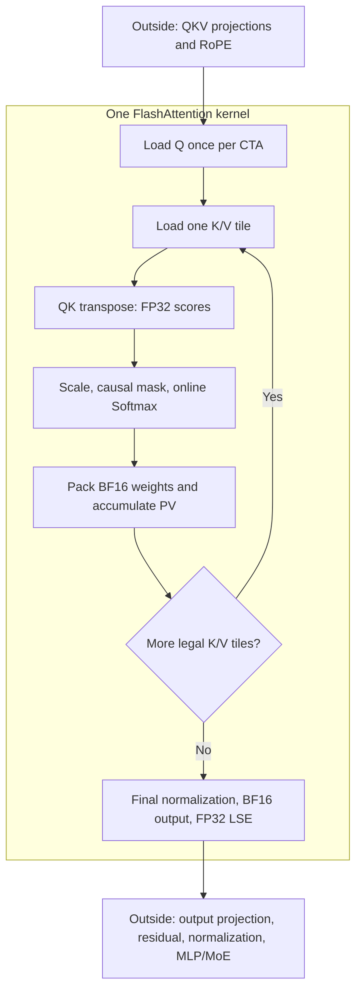

# Reproducing Hopper FlashAttention with CUDA and PTX

This walkthrough follows the 23 source-order sections of `sm90_forward.cu`: a fixed BF16, D128 causal forward kernel, built around FA3's Hopper pipeline with selected FA4 software strategies. The emphasis is on how layouts, numerical state, and asynchronous execution fit together—not a line-by-line transcription.

## 01. Computation, types, and fixed tile sizes

For one query row, attention computes:

$$
s_{ij}=q_i^T k_j,\qquad z_{ij}=\sigma s_{ij},\qquad
O_i=\frac{\sum_{j\le i}\exp(z_{ij})v_j}{\sum_{j\le i}\exp(z_{ij})}.
$$

The usual attention scale is $\sigma=1/\sqrt{128}$. This is equal-length causal prefill, not single-token decode. Use MHA as the running example; the same implementation maps query heads to shared KV heads for GQA/MQA.

| Tensor | Shape | Storage |
|---|---|---|
| Q | `[B,T,Hq,128]` | BF16 |
| K, V | `[B,T,Hkv,128]` | BF16 |
| Output | `[B,T,Hq,128]` | BF16 |
| LSE | `[B,Hq,T]` | FP32 |

`B` counts sequences, `T` counts tokens per sequence, and `Hq/Hkv` counts query/KV heads. LSE is the natural logarithm of the Softmax denominator, retained as a compact row statistic rather than a full probability matrix.



The complete $T\times T$ score and probability matrices never become global-memory intermediates. Inside the loop, the variable `O` actually holds an unnormalized numerator $U$; `P` holds unnormalized exponential weights. Only the epilogue forms $O=U/\ell$.

The fixed geometry is `BM=BN=D=128`, but these are different axes: query tokens, key tokens, and head features. One CTA owns 128 query rows for one batch/head. Two consumer Warp Groups each own 64 rows and reuse K/V; a third Warp Group produces data. `STAGES=2` counts temporal slots, while `GROUPS=8` counts 16-column register fragments—not GQA groups.

## 02. Shared storage and lifetime

The declaration separates three different partitions: feature bands, temporal slots, and consumer row ownership.

```cpp
bf16 Q[2][128 * 64];
bf16 K[2 /* stages */][2 /* bands */][128 * 64];
bf16 V[2 /* stages */][2 /* bands */][128 * 64];
```

A feature band contains either columns 0–63 or 64–127 of **all 128 rows**. C0/C1 instead divide the rows into 0–63 and 64–127. Both consumers need both bands. A temporal slot holds one complete tile until both consumers finish reading it.

| Storage | Calculation | Size |
|---|---|---:|
| Q | 2 bands × 128 × 64 × 2 bytes | 32 KiB |
| K | 2 slots × one 32 KiB tile | 64 KiB |
| V | 2 slots × one 32 KiB tile | 64 KiB |
| Total payload | Q + K + V | 160 KiB |

Q remains unchanged throughout the CTA's scan, so it has no temporal double buffer. K and V each have two slots: compute can consume one while TMA fills another, provided the previous readers have released it.

```text
Shared payload offsets:
0              32 KiB                96 KiB               160 KiB
| Q: 32 KiB    | K slots: 64 KiB      | V slots: 64 KiB       |
                                    | O: 32 KiB | unused    |
                                      epilogue only
```

A C++ union overlays the 32 KiB output staging area with the beginning of V. It saves space because V is no longer needed when output is stored. It does **not** synchronize users of that memory. The epilogue must wait for both consumers' final PV operations before any output write; a second synchronization later protects TMA's read of the completed output.

The allocation adds 1023 bytes so an initially less-aligned pointer can be rounded upward to a 1024-byte boundary without losing payload capacity. Static barriers occupy additional shared storage. This lifetime-based reuse also appears in the official Hopper kernel's shared-storage organization.

## 03. Encoding the five-dimensional Tensor Map

A `CUtensorMap` describes an existing global tensor to TMA. The host function `cuTensorMapEncodeTiled()` encodes its address, dimensions, byte strides, transfer box, and shared-memory swizzle. It neither allocates a replacement tensor nor starts a copy.

Start with contiguous `X[B,T,H,128]`. Split a feature index as $f=64u+d$, where $u\in\{0,1\}$ and $0\le d<64$. The byte address is:

$$
\operatorname{offset}=256THb+256Ht+256h+128u+2d.
$$

| Descriptor coordinate | Extent | Byte stride |
|---|---:|---:|
| d | 64 | 2, implicit |
| token | T | 256H |
| head | H | 256 |
| band | 2 | 128 |
| batch | B | 256TH |

This coordinate order is **not** an ascending ordering of global strides. The explicit strides preserve the original tensor layout.

~~~text
Global shape:    [64, T,   H, 2, B]
Transfer box:    [64, 128, 1, 2, 1]
Element stride: [1,  1,   1, 1, 1]
Start:          [0, token, head, 0, batch]
~~~

The box covers $64\times128\times2=16384$ BF16 elements: a full 32 KiB tile. For `H=8,t=1,h=0,u=1,d=0,b=0`, the byte offset is $2048+128=2176$: token 1, head 0, feature 64.

Why split D? For this non-interleaved SW128 mapping, the innermost box width is limited to 128 bytes. A 128-element BF16 row is 256 bytes; two bands of 64 elements satisfy the mapping constraint without changing the mathematical head dimension. See the [Tensor Map API](https://docs.nvidia.com/cuda/archive/12.8.1/cuda-driver-api/group__CUDA__TENSOR__MEMORY.html).

D256 could use four bands, but that alone would not produce a D256 kernel: unchanged tile/stage geometry would require 320 KiB of Q/K/V shared storage, and output registers would also grow. This implementation stays D128.

Q/output maps use Hq; K/V maps use Hkv. Confusing these strides breaks GQA even if MHA appears correct.

## 04. Barriers: arrivals, transaction bytes, and parity

The pipeline must prevent two different hazards: consuming an incomplete copy and overwriting data still being read. Each K/V slot therefore has two barriers.

| Barrier | Completion condition | Waiting side |
|---|---|---|
| Full | Producer arrival plus 32768 completed TMA bytes | Consumers |
| Empty | One release from each of the two consumers | Producer |

`mbarrier.init.shared::cta.b64` initializes a shared-memory barrier with an expected arrival count. Here Full uses 1 and Empty uses 2; these count protocol participants, not all threads in the CTA. `barrier_address()` converts a generic pointer into the 32-bit shared address expected by these PTX instructions.

`mbarrier.arrive.expect_tx.release.cta.shared::cta.b64` combines an arrival with an expected transaction-byte increment. Here it announces a 32 KiB TMA copy. The copy itself later completes those bytes. Issuing the copy is not enough to make Full ready.

`mbarrier.arrive.release.cta.shared::cta.b64` records an arrival without adding transaction bytes. Here one elected thread per consumer releases a slot **after** that consumer's WGMMA has finished reading it.

~~~mermaid
flowchart LR
    E["Empty completed"] --> T["Producer announces bytes and issues TMA"]
    T --> F["Full completed: arrival and bytes"]
    F --> C["C0 and C1 read the tile"]
    C --> W["Each waits for its WGMMA and releases Empty"]
    W --> E
~~~

`mbarrier.try_wait.parity.acquire.cta.shared::cta.b64` waits for completion of a phase identified by parity. The phase is a reuse generation, not a buffer index. Initially phase 0 is active; waiting on phase 0 means waiting for that phase to finish, not waiting for the barrier's current parity to equal zero.

The helper tries once, then retries with `0x989680`. This is a **10,000,000-nanosecond suspension hint**, not GPU cycles or a safety timeout. Even the form without a hint may suspend; it is not the nonblocking `test_wait` instruction. A failed attempt loops again. See [PTX wait semantics](https://docs.nvidia.com/cuda/archive/12.8.1/parallel-thread-execution/index.html#parallel-synchronization-and-communication-instructions-mbarrier-test-wait-try-wait).

Release/acquire handles ordering within the protocol. A compiler `"memory"` clobber is not a hardware wait, and an arrival does not automatically finish outstanding WGMMA work.

## 05. TMA loading and circular-slot advancement

The PTX `cp.async.bulk.tensor.5d` family initiates an asynchronous tensor copy using a Tensor Map and five coordinates. Here the direction is global to shared; `mbarrier::complete_tx::bytes` associates copy completion with the supplied Full barrier.

~~~ptx
cp.async.bulk.tensor.5d.shared::cluster.global
    .mbarrier::complete_tx::bytes.L2::cache_hint
    [destination], [map, {0, token, head, 0, batch}], [barrier], hint;
~~~

The wrapped lines above represent one instruction. `destination` chooses the physical shared slot; the map selects the tensor and layout; coordinates select the global tile. Starting at band 0 still copies both bands because the box extent is 2. For `token=256,head=3,batch=0`, this reads the logical slice `X[0,256:384,3,0:128]`.

The `Query` template parameter chooses an L2 replacement hint: evict-first for Q, evict-last for K/V. It does not select the source tensor—that comes from the map. The preference reflects Q's per-CTA use versus potential K/V reuse across CTAs; it does not reserve cache lines.

The copy protocol, in pseudocode, is:

~~~text
wait Empty[slot] for this producer generation
arrive and expect 32768 bytes on Full[slot]
issue tensor copy into slot
advance producer cursor
~~~

Advancement only updates bookkeeping:

~~~cpp
if (++stage == STAGES) {
    stage = 0;
    phase ^= 1;
}
~~~

| Tile use number | Slot | Full wait phase |
|---:|---:|---:|
| 0 | 0 | 0 |
| 1 | 1 | 0 |
| 2 | 0 | 1 |
| 3 | 1 | 1 |

A cursor advance does not complete a copy or release a slot. Producer and consumer keep their own cursors; Empty also has a startup pre-arrival, explained in section 20. K and V share the two-slot geometry but have independent readiness/release barriers.

## 06. SW128 and the WGMMA shared descriptor

TMA and WGMMA need different descriptions of the same data:

| Object | Reader | Describes |
|---|---|---|
| `CUtensorMap` | TMA | Global tensor and transfer layout |
| 64-bit shared descriptor | WGMMA | Shared operand address and matrix layout |

~~~mermaid
flowchart LR
    G["Global Q/K/V"] -->|"Tensor Map + TMA"| S["SW128 shared tile"]
    S -->|"WGMMA descriptor"| R["FP32 register accumulators"]
~~~

A band row contains 64 BF16 values, or eight 16-byte chunks. In this aligned layout:

~~~cpp
physical_chunk = logical_chunk ^ (row & 7);
physical_element = row * 64 + (col ^ ((row & 7) << 3));
~~~

| Row | Physical positions for logical chunks 0–7 |
|---:|---|
| 0 | 0 1 2 3 4 5 6 7 |
| 1 | 1 0 3 2 5 4 7 6 |
| 2 | 2 3 0 1 6 7 4 5 |
| 3 | 3 2 1 0 7 6 5 4 |

For row 3, column 17, the logical chunk is 2 and the within-chunk index is 1. XOR gives chunk $2\mathbin{\mathrm{xor}}3=1$, so the physical element offset is $3\times64+1\times8+1=201$, or 402 bytes. Chunk numbers are not bank numbers. The permutation changes bank access patterns while preserving each chunk's contiguous eight BF16 values.

The WGMMA descriptor encodes addresses/offsets in 16-byte units:

~~~cpp
encode(value) = (value & 0x3ffff) >> 4;
descriptor = encode(shared_start)
           | (encode(leading_bytes) << 16)
           | (encode(1024) << 32)
           | (1ULL << 62);
~~~

The top two bits `01` select SW128. Q/K use the K-major layout with `leading_bytes=16`; V uses MN-major with `leading_bytes=16384`, spanning the second feature band. These fields describe WGMMA's layout atoms, not ordinary C++ row strides.

`advance_descriptor` updates the low word by an already-encoded offset while keeping layout fields fixed. Section 10 derives the different QK and PV increments. A matching descriptor interprets the swizzled data; it does not physically transpose or rearrange it.

## 07. WGMMA ordering: fence, commit, wait

WGMMA is asynchronous. Ordinary register accesses and asynchronous matrix work must be ordered explicitly; merely writing calls in C++ source order is insufficient.

| Mechanism | General effect | Role here |
|---|---|---|
| Empty asm with `+f` / `+r` | Declares compiler-visible register reads/writes | Keeps score, output, and packed-P dependencies visible |
| `wgmma.fence.sync.aligned` | Orders preceding register accesses before subsequent WGMMA accesses | Establishes operand ordering before issue |
| `wgmma.commit_group.sync.aligned` | Commits preceding uncommitted WGMMA operations as a group | Groups eight native MMA steps into one tile operation |
| `wgmma.wait_group.sync.aligned N` | Waits until at most the newest N committed groups remain pending | Exposes QK results early, then drains PV before modifying P/O |

The empty asm constraints do not calculate anything. `+f` denotes a read/write FP32 register and `+r` a read/write integer register; `"memory"` limits compiler memory motion. None substitutes for a hardware completion wait.

Consider two commits in this order:

~~~text
commit A: QK(next)
commit B: PV(current)

wait<1> → A completed; B may still be running
          read next_scores and release K

wait<0> → A and B completed
          overwrite P, release V, rescale O
~~~

The number is a pending-group limit, not a group ID. Completion of A does not imply completion of B; conversely B may already have completed by the time the first wait returns. This permits overlap rather than guaranteeing a particular timing.

The Full barrier and WGMMA wait answer different questions: **has TMA written the input?** versus **has the matrix operation finished using it and producing its result?** The consumer needs both before it can safely recycle a shared slot. CUTLASS exposes the same hardware operations through its [Hopper WGMMA wrappers](https://github.com/NVIDIA/cutlass/blob/7127592069c2fe01b041e174ba4345ef9b279671/include/cute/arch/mma_sm90_gmma.hpp).

## 08. QK WGMMA: shared/shared operands and register ownership

`wgmma.mma_async.sync.aligned.m64n128k16.f32.bf16.bf16` asks a 128-thread Warp Group to perform a BF16 matrix product with FP32 accumulation. In this SS form, both inputs are shared-memory descriptors. Here it computes 16 feature contributions to the scores for 64 queries and 128 keys:

$$
S_{64\times128}\leftarrow Q_{64\times16}K^T_{16\times128}+\text{optional }S.
$$

A shortened operand listing makes the controls visible:

~~~ptx
wgmma.mma_async.sync.aligned.m64n128k16.f32.bf16.bf16
    {64 FP32 registers}, desc_Q, desc_K, ScaleD, 1, 1, 0, 0;
~~~

| Operand | Meaning here |
|---|---|
| 64 FP32 registers | This thread's output fragment, not the whole matrix |
| desc_Q, desc_K | Two 64-bit shared descriptors |
| ScaleD | 0 overwrites the accumulator; 1 accumulates |
| 1, 1 | Positive input signs |
| 0, 0 | K-major operand layout selectors for Q and K |

The instruction's reduction dimension K=16 means **features**, not 16 key tokens. `ScaleD` is not the attention scale. The layout selectors are hardware operand interpretations, not commands to transpose global arrays.

### From CTA to lane

~~~text
CTA: 128 query rows × 128 key columns
  C0: rows 0–63       C1: rows 64–127
  each consumer: four warps, each owning 16 rows × 128 columns
  each warp: eight four-lane quads
  each lane: two rows × 32 columns = 64 FP32 values
~~~

Within a consumer, define:

~~~cpp
r0 = warp * 16 + lane / 4;
r1 = r0 + 8;
c  = g * 16 + 2 * (lane & 3);  // g = 0..7
~~~

For warp 0, quad 0, g=0:

| Lane | Columns in row 0 and row 8 |
|---:|---|
| 0 | 0, 1, 8, 9 |
| 1 | 2, 3, 10, 11 |
| 2 | 4, 5, 12, 13 |
| 3 | 6, 7, 14, 15 |

For any lane, slots 0/1/4/5 belong to r0 at columns c/c+1/c+8/c+9; slots 2/3/6/7 belong to r1 at those same columns. Increasing g shifts all columns by 16. Thus g is a register-column group, not a head or Warp Group.

This native accumulator layout explains later quad reductions and BF16 packing. Treating each lane's fragment as a contiguous 8×8 tile would give incorrect row statistics and stores.

## 09. PV WGMMA: register/shared operands

The RS form of `wgmma.mma_async` reads its A operand from registers and its B operand from shared memory. Here that connects Softmax directly to the second GEMM:

$$
U_{64\times128}\leftarrow U_{64\times128}
+\widetilde P_{64\times16}V_{16\times128}.
$$

$\widetilde P$ denotes unnormalized exponential weights rounded to BF16. They remain in registers; there is no probability-tile store to shared memory between Softmax and PV.

~~~ptx
wgmma.mma_async.sync.aligned.m64n128k16.f32.bf16.bf16
    {64 FP32 registers}, {A0, A1, A2, A3}, desc_V, 1, 1, 1, 1;
~~~

| Operand/control | Interpretation |
|---|---|
| A0–A3 | Four 32-bit registers per thread, each packing two BF16 weights |
| desc_V | V's shared descriptor |
| First trailing 1 | Preserve and accumulate into U |
| Next two 1s | Positive A/B signs |
| Last 1 | MN-major B layout selector |

Unlike SS, this form has no A transpose selector: A already follows the required register layout. Across 128 threads, four packed registers provide $128\times4\times2=1024$ BF16 elements, exactly a 64×16 A operand.

| Axis | QK | PV |
|---|---|---|
| M=64 | Query rows | Query rows |
| N=128 | Key tokens | Output features |
| K=16 | Features being reduced | Key tokens being reduced |

V is logically `V[key,feature]`. Its MN-major descriptor lets WGMMA consume the existing TMA-swizzled storage without a physical transpose. The selector does not change PV into $PV^T$.

Because every PV instruction accumulates, U starts at zero and survives across KV tiles. Its scale may change with the Softmax exponent base, but it is not divided by the denominator until the epilogue.

## 10. Issuing a complete QK or PV tile

The helpers `issue_qk` and `issue_pv` turn one native K16 instruction into a complete reduction of width 128. Each issues eight MMA steps and commits them as one asynchronous group; the caller decides when to wait.

For QK, the two D64 bands each supply four steps:

~~~text
operand fences
band 0:
    step 0: S = Q[0:16] × K[0:16]^T
    steps 1..3: add feature slices 16:32, 32:48, 48:64
band 1:
    steps 0..3: add feature slices 64:80, ..., 112:128
commit one QK group
~~~

Q's shared base also includes `consumer * 64 * HALF_D`, selecting the consumer's 64 query rows. Both consumers use the same K descriptors.

Descriptor increments are already in 16-byte units. A QK step advances 16 BF16 features, hence $16\times2/16=2$ encoded units. The helper builds each band's base once and adds `k*2` instead of rebuilding every field.

For PV, each step consumes 16 key tokens:

~~~text
operand fences
for k in 0..7:
    U += P[k] × V[keys 16*k : 16*k+16, all 128 features]
commit one PV group
~~~

Moving 16 V rows within a D64 band advances $16\times64\times2=2048$ bytes, or 128 encoded units. The MN-major descriptor already describes both feature bands; it is not necessary to issue separate V0 and V1 loops.

| Detail | QK | PV |
|---|---:|---:|
| Native instructions per tile | 8 | 8 |
| Encoded increment per step | 2 | 128 |
| First instruction preserves accumulator? | No | Yes |
| Reduction axis | 128 features | 128 key tokens |

These are reduction steps inside one KV tile, not eight different temporal tiles. Waiting after every step would destroy the opportunity to pipeline the complete QK/PV groups with other work.

## 11. Packing probabilities and evaluating base-2 exponentials

The same score registers change meaning as data flows through the kernel:

~~~mermaid
flowchart LR
    A["QK: FP32 dot products"] --> B["Online Softmax: FP32 exponential weights"]
    B --> C["pack_probabilities: BF16 pairs in uint32"]
    C --> D["RS WGMMA: FP32 numerator U"]
~~~

`__floats2bfloat162_rn(a,b)` rounds two FP32 values to BF16 using round-to-nearest-even and packs them: a occupies the low 16 bits, b the high 16 bits. The resulting bit pattern is supplied as a 32-bit integer operand, **not numerically converted into an integer**.

~~~text
For each g:
    P[g][0] = pack_BF16(scores[g][0], scores[g][1])
    P[g][1] = pack_BF16(scores[g][2], scores[g][3])
    P[g][2] = pack_BF16(scores[g][4], scores[g][5])
    P[g][3] = pack_BF16(scores[g][6], scores[g][7])
~~~

For lane 0, g=0, these pairs represent row 0 columns 0/1, row 8 columns 0/1, row 0 columns 8/9, and row 8 columns 8/9. This is precisely the per-thread A-operand arrangement for the next K16 PV step. No cross-lane shuffle is required.

For an exactly representable example, packing 1.0 and 2.0 produces BF16 halves `0x3f80` and `0x4000`, hence the register bit pattern `0x40003f80`. Arbitrary weights generally lose precision; FP32 accumulation does not undo that rounding.

The other helper uses `ex2.approx.ftz.f32`: an approximate FP32 base-2 exponential, with flush-to-zero handling of subnormal values. Here it evaluates online weights and rescaling factors. With $\lambda=\sigma\log_2(e)$:

$$
\exp(\sigma(s-m))=2^{s\lambda-m\lambda}.
$$

Softmax forms the exponent with an FMA before calling this helper. Using base 2 changes the implementation, not the intended Softmax function; the actual arithmetic remains approximate.

## 12. Online Softmax: coordinates, causal mask, and maximum

The first half of `online_softmax<First,Masked>` finds a candidate exponent base. It reconstructs matrix coordinates from the accumulator layout, masks future tokens, and reduces each row's maximum.

`First` means the first KV tile for this consumer, not token zero. `Masked` determines at compile time whether individual causal comparisons are needed. For equal BM/BN, the reverse traversal begins at the diagonal tile and visits only earlier tiles:

| Query block \ Key block | 0 | 1 | 2 | 3 |
|---|---|---|---|---|
| 0 | Mask | Skip | Skip | Skip |
| 1 | Full | Mask | Skip | Skip |
| 2 | Full | Full | Mask | Skip |
| 3 | Full | Full | Full | Mask |

Even block (0,0) is triangular, not fully valid. Skipped blocks are never loaded or computed. Only the diagonal needs per-element masking; all earlier blocks compile into the unmasked loop.

Coordinates use the section-08 mapping:

~~~text
query = query_start + r0 or r1
key   = key_start + c, c+1, c+8, or c+9
if key > query:
    score = -FLT_MAX
~~~

For query token 136 in the key tile starting at 128, only keys 128–136 survive. Even a very large score at key 137 must be excluded before the maximum reduction.

Each lane owns 32 columns per row. The code uses four independent maximum chains, merges them as a tree, then exchanges results inside its four-lane quad using XOR masks 1 and 2. For local maxima:

~~~text
lanes:       0  1  2  3
local max:   4  7  3  6
XOR 1 max:   7  7  6  6
XOR 2 max:   7  7  7  7
~~~

The full shuffle participation mask does not make this a 32-lane reduction: XOR 1/2 changes only the low two lane bits. Other quads represent different rows and must not be mixed.

On later tiles, the old exponent base is merged into the candidate before this quad reduction. Four chains shorten serial dependencies; they do not eliminate the required comparisons. The finite negative sentinel works for these valid causal rows, which always have at least one permitted key.

## 13. Online Softmax: exponent base, weights, and denominator

The variable `row_max` is the **retained exponent base in raw-score units**. With thresholded updates, it need not equal the largest score observed so far.

Let $m$ be this base, $\lambda=\sigma\log_2(e)$, and $b=m\lambda$ its base-2 counterpart. Represent weights and state as:

$$
p_j=2^{s_j\lambda-b},\qquad
\ell=\sum_jp_j,\qquad U=\sum_jp_jv_j.
$$

Changing the base from b to b' requires $\alpha=2^{b-b'}$:

$$
\ell'=\alpha\ell+\sum_{\text{new}}p'_j,\qquad
U'=\alpha U+\sum_{\text{new}}p'_jv_j.
$$

Both numerator and denominator must use the same base. The ratio is then unchanged by the choice of base in exact arithmetic.

### Why retain the old base within eight log2 units?

The implementation uses:

~~~text
candidate = max(old_base, current_tile_max)
change = (old_base - candidate) * scale_log2
if not first_tile and change >= -8:
    selected_base = old_base
    factor = 1
else:
    selected_base = candidate
    factor = first_tile ? 1 : exp2(change)
~~~

Keeping the base also keeps the old numerator and denominator scale. This does **not** approximate a small rescaling factor as 1 while switching the base. The base itself is retained. New weights can then exceed 1, up to about $2^8=256$ under the threshold.

For a concrete example, work in base-2 coordinates. Initially $b=10,\ell=3,U=6$. Two new scores are 12 and 11, with scalar values 10 and 2. The base stays 10:

$$
p_1=4,\quad p_2=2,\quad
\ell'=3+4+2=9,\quad U'=6+4(10)+2(2)=50.
$$

The output is $50/9$. Updating immediately to base 12 would give $\ell'=2.25,U'=12.5$, the same ratio. If the candidate instead rises to 20, the gap exceeds eight and the old state must be multiplied by $2^{-10}$.

The threshold avoids repeated output rescaling while bounding how far the base trails new maxima. It is a software policy, not a BF16 exponent-bit rule. The corresponding thresholded-base strategy is visible in [official FA4 Softmax](https://github.com/Dao-AILab/flash-attention/blob/94e22c906678e5483fa0e9e24d8e787bc2c0ed4c/flash_attn/cute/softmax.py); the value 8 is the choice in this kernel.

Finally, scores become exponentials in place. Four independent FP32 addition chains produce each lane's local sum. The local denominator is rescaled and updated, but the four lanes are not summed together yet. Deferring that reduction until section 15 saves per-tile communication. Output rescaling is a separate operation because PV may still be writing U.

## 14. Rescaling the output numerator

`scale_output` converts the existing FP32 numerator to the selected exponent base. It does not apply the attention scale or perform final normalization.

~~~text
if (!warp_any(factor[0] != 1 || factor[1] != 1))
    return;
for each g and slot:
    output[g][slot] *= factor[(slot & 2) >> 1];
~~~

Each lane owns parts of two rows. Bit 1 of the slot index selects which row:

| Slots | Row | Factor |
|---|---|---|
| 0, 1, 4, 5 | r0 | factor[0] |
| 2, 3, 6, 7 | r1 | factor[1] |

For example, one register group may contain:

~~~text
before: [1024, 2048, 10, 20, 3072, 4096, 30, 40]
factor: [1/1024 for r0, 1 for r1]
after:  [   1,    2, 10, 20,    3,    4, 30, 40]
~~~

The implementation's `__any_sync` makes the skip decision uniform across the warp. If every represented row retains its base, all output multiplications are skipped. If any row changes, the loop runs for the entire warp; unchanged rows simply multiply by 1.

Three scales must remain distinct:

| Quantity | Purpose |
|---|---|
| $\sigma=1/\sqrt D$ | Fixed attention-logit scaling |
| $\alpha=2^{(m_{\rm old}-m_{\rm new})\lambda}$ | Dynamic correction when the exponent base changes |
| $1/\ell$ | Final normalization after all KV tiles |

A fixed base would be mathematically sufficient if all arithmetic remained finite. Online adjustment is needed because overflow or severe underflow can occur before the final division. Changing only `row_max` at the end cannot repair invalid intermediate values and would make LSE inconsistent with the retained sum.

In the asynchronous loop, rescaling must follow the wait for the current PV, so its newly added contribution is corrected together with the old numerator.

## 15. Final row sums, reciprocals, and LSE

After the last Softmax update, each lane still holds only its contribution to each row's denominator. `finalize_rows` combines those partial sums, computes the inverse denominator, and forms LSE.

~~~text
For each of the lane's two rows:
    sum += shuffle_xor(sum, 1)
    sum += shuffle_xor(sum, 2)
    inverse = approximate_reciprocal(sum)
    LSE = retained_raw_base * attention_scale + log(sum)
~~~

With local sums [1,2,3,4], the quad evolves as follows:

| Step | Lane 0 | Lane 1 | Lane 2 | Lane 3 |
|---|---:|---:|---:|---:|
| Local | 1 | 2 | 3 | 4 |
| XOR 1 addition | 3 | 3 | 7 | 7 |
| XOR 2 addition | 10 | 10 | 10 | 10 |

No new maximum reduction is needed: the selected base is already shared by the four lanes. The sum is now replicated so each lane can normalize its own output columns.

The PTX instruction `rcp.approx.ftz.f32` computes an approximate FP32 reciprocal with subnormal flush-to-zero behavior. Here it turns the final positive denominator into a multiplier reused across output elements, instead of dividing each element separately. Quad lanes repeat this calculation for their copies of the same row statistic.

Why is LSE not just `log(sum)`? The stored denominator uses shifted scores:

$$
\ell=\sum_j e^{\sigma(s_j-m)},\qquad
\operatorname{LSE}=\log\sum_j e^{\sigma s_j}
=\sigma m+\log\ell.
$$

For $m=4,\sigma=0.5,\ell=10$, LSE is $2+\log(10)\approx4.302585$. The logarithm is natural, even though the exponential path used base 2.

This works with a retained base below the true maximum, provided it is the same base used for the sum. Finalization does not inspect U, so it can execute while the last PV is outstanding. Output normalization must still wait for that PV.

## 16. Output normalization, stmatrix, and LSE stores

`store_output` normalizes each FP32 accumulator element, rounds it to BF16, and stages it in shared memory. It does not itself perform the final global TMA store.

~~~mermaid
flowchart LR
    U["FP32 U registers"] --> N["Multiply by row reciprocal"]
    N --> P["Round and pack BF16 pairs"]
    P --> S["stmatrix: registers to SW128 shared O"]
    S --> T["Later: one TMA store to global O"]
~~~

The PTX instruction `stmatrix.sync.aligned.x4.m8n8.shared.b16` is a warp-cooperative store of four 8×8 matrices of 16-bit elements. Here it transforms the WGMMA accumulator arrangement into the shared output layout expected by TMA.

For a fixed warp and g, the four matrices tile a 16×16 region:

~~~text
                 columns 0–7    columns 8–15
rows 0–7         matrix 0       matrix 2
rows 8–15        matrix 1       matrix 3
~~~

Each lane supplies four packed registers. Across the warp, that is $32\times4\times2=256$ BF16 values, exactly the 16×16 region. Eight g iterations cover all 128 output features.

**Data ownership and address provision are different mappings.** A lane owns accumulator rows through `lane/4`, but supplies stmatrix row addresses through `lane&15`. The instruction moves the collectively supplied data into the addressed matrices; it is not four ordinary per-thread stores.

The destination calculation is:

~~~cpp
row = consumer_row_offset + warp * 16 + (lane & 15);
column = g * 16 + (lane >> 4) * 8;
band = column / 64;
offset = row * 64 + ((column % 64) ^ ((row & 7) << 3));
~~~

For row 3 and band-local column 8, the swizzled element offset is $192+(8\mathbin{\mathrm{xor}}24)=208$. The instruction has no separate SW128 flag: the address calculation and subsequent Tensor Map must agree.

LSE uses ordinary global stores. Only the first lane of each quad writes its two row statistics, avoiding four identical writers. Its linear index is `(batch*Hq+head)*T+token`, unlike the output tensor's `[B,T,Hq,D]` layout. The next sections explain when V's aliased storage becomes safe for these output writes.

## 17. Kernel entry, shared alignment, and initialization

The earlier functions define building blocks. The kernel now connects them, beginning with storage and synchronization state.

~~~text
Align dynamic shared payload
    → one thread prefetches descriptors and initializes barriers
    → publish initialization to the async proxy
    → synchronize the CTA
    → identify producer and consumer groups
~~~

The dynamic allocation is initially declared with 16-byte alignment. It is explicitly rounded upward:

~~~cpp
aligned = (shared_address + 1023) & ~1023;
~~~

For example, shared address 1040 becomes 2048. Even if a compiler knows that a C++ type is aligned, the runtime address must actually satisfy that alignment; the extra 1023 allocated bytes cover the worst adjustment. Each static 64-bit barrier is separately 8-byte aligned.

`prefetch.tensormap` brings a Tensor Map descriptor toward the hardware's descriptor cache. Here thread 0 prefetches Q/K/V/O maps; it does **not** load Q/K/V matrix data. The `__grid_constant__` parameters provide grid-constant descriptor objects whose addresses can be used by TMA.

Thread 0 initializes:

| Barrier | Number | Expected arrivals each |
|---|---:|---:|
| query_full | 1 | 1 |
| k_full, v_full | 2 slots each | 1 |
| k_empty, v_empty | 2 slots each | 2 |

`fence.proxy.async.shared::cta` establishes ordering between ordinary shared-memory operations and the async proxy. Here it publishes initialized barrier state before asynchronous use. `__syncthreads()` then makes all CTA threads pass the initialization point together.

Thread roles are fixed:

| CTA thread index | group | Role |
|---|---:|---|
| 0–127 | 0 | Producer Warp Group |
| 128–255 | 1 | Consumer C0: first 64 query rows |
| 256–383 | 2 | Consumer C1: second 64 query rows |

The local `tid=threadIdx.x%128` is the thread index within a Warp Group, not the CTA-wide thread index. Thus `tid==0` identifies three different threads before the producer branch returns. This distinction is essential when counting barrier arrivals.

## 18. Static CTA mapping and GQA head selection

Each CTA computes one batch, one query head, and one 128-row query tile. The mapping gives longer causal tasks smaller logical block indices within a head section.

~~~text
query_blocks = ceil(T / 128)
section_tiles = section_heads * query_blocks
section, local = divmod(blockIdx.x, section_tiles)

query_block = query_blocks - 1 - local / section_heads
head_batch = section * section_heads + local % section_heads
batch, head = divmod(head_batch, Hq)
kv_head = head / (Hq / Hkv)
~~~

All divisions in this pseudocode are integer divisions. The host supplies `section_heads`; section 23 derives it from a working-set budget.

For a small illustration, take T=512, Hq=8, and a supplied section size of 2 heads. In section 0:

| blockIdx.x | Query block | Query rows | Query head |
|---:|---:|---|---:|
| 0 | 3 | 384–511 | 0 |
| 1 | 3 | 384–511 | 1 |
| 2 | 2 | 256–383 | 0 |
| 3 | 2 | 256–383 | 1 |
| 6 | 0 | 0–127 | 0 |
| 7 | 0 | 0–127 | 1 |

Later query blocks have more valid keys, so they require more work. Assigning them earlier logical indices is a longest-processing-time-style strategy. Keeping nearby heads together can also improve K/V locality. This is a static mapping, not a persistent task queue or a guarantee of hardware execution order.

Head sharing is independent of tile scheduling:

| Mode | Hq | Hkv | Mapping |
|---|---:|---:|---|
| MHA | 8 | 8 | query head h uses KV head h |
| GQA | 8 | 2 | query heads 0–3 use KV 0; 4–7 use KV 1 |
| MQA | 8 | 1 | all query heads use KV 0 |

For GQA, Q head 5 still uses its own Q/output address, but reads KV head 1 with Hkv-based strides. The current fixed shapes divide the head sections exactly; the mapping is not a general ragged-head scheduler.

## 19. Producer: load Q once, prefetch K one tile ahead

The producer Warp Group executes `setmaxnreg.dec.sync.aligned.u32 24`. This PTX operation reduces its per-thread register allocation, making registers available to the compute-heavy consumers. It does not move matrix data. All producer threads participate in the allocation change; only local tid 0 issues TMA requests.

The producer loads Q once, primes the diagonal K tile, and then walks backward through legal keys:

~~~text
announce Q bytes; issue Q copy
wait K slot 0 Empty; announce K bytes; issue K[q]

for i = q down to 0:
    if i > 0:
        wait next K slot Empty
        announce bytes; issue K[i-1] into next slot
    wait current V slot Empty
    announce bytes; issue V[i] into current slot
    advance slot and phase
~~~

For Q384–511, q=3. The issue sequence is:

~~~text
Q, K3, K2, V3, K1, V2, K0, V1, V0
~~~

This is issue order, not a measured completion timeline. The extra K lookahead supplies QK(next) before PV(current), matching the consumer pipeline.

| Logical tile | K slot | V slot | Full phase |
|---:|---:|---:|---:|
| 3 | 0 | 0 | 0 |
| 2 | 1 | 1 | 0 |
| 1 | 0 | 0 | 1 |
| 0 | 1 | 1 | 1 |

K and V use corresponding slots for the same logical tile, but their release times differ: K can be recycled after QK, whereas V must remain until PV finishes. Independent Empty barriers preserve that distinction.

The Q cache hint is selected with `tma_load<true>`; K/V use the default hint. Q has no Empty recycling loop because this CTA never replaces its Q tile.

After issuing its work, the producer branch returns. The consumer groups have been running concurrently, not waiting for the producer's entire loop to finish. Their later named barriers therefore count only 256 consumer threads. The K-next/V-current organization corresponds to the load pipeline in the [official Hopper mainloop](https://github.com/Dao-AILab/flash-attention/blob/94e22c906678e5483fa0e9e24d8e787bc2c0ed4c/hopper/mainloop_fwd_sm90_tma_gmma_ws.hpp).

## 20. Consumer prologue: startup and the first QK

Consumers execute `setmaxnreg.inc.sync.aligned.u32 240`, increasing their register allocation for scores, P, U, and row statistics. This is an allocation limit, not a claim that every thread has exactly 240 live values.

Two distinct startup actions follow. First, all 128 threads of C0 execute `bar.arrive 1,256`, seeding the named scheduling barrier. `bar.arrive` contributes arrivals without waiting; later `bar.sync` contributes arrivals and waits. These named barriers coordinate consumer turns, not TMA byte completion.

Second, one elected thread from **each** consumer arrives at every K/V Empty barrier. Two arrivals complete the initial Empty phase, allowing the producer to fill previously unused slots. Doing this before waiting on Q prevents a startup circular dependency.

~~~text
C0: seed scheduling barrier 1
C0 leader + C1 leader: release all initial Empty slots
both consumers: wait query_full
~~~

For the running example, C0 owns Q384–447 and C1 owns Q448–511. Each creates zeroed U, local row sums, initial negative bases, and a packed-P array. U needs zero initialization because PV always accumulates; score registers are overwritten by the first QK instruction.

The prologue then establishes the first probability tile:

~~~text
wait first K Full
issue QK(diagonal); wait<0>
release this consumer's K use
online_softmax<First=true, Masked=true>
pack P
remember current V slot
advance K cursor to the next tile
~~~

The Full wait protects against unfinished TMA writes; the WGMMA wait protects against unfinished score computation. Once QK completes, shared K is no longer needed for Softmax, so it can be released early.

| State after the prologue | For query block 3 |
|---|---|
| P | P3, ready for PV |
| row_sum | Includes tile 3 weights |
| U | Still zero |
| value_stage | Slot containing V3 |
| stage | Slot for K2 |

The initial QK is not gated by the steady-state turn-taking barrier. The startup seed prepares later alternation. No PV has run yet: the loop must consume P3V3, and if this is the only legal tile, the drain section performs it directly.

## 21. Consumer steady state: handoff, overlap, delayed rescaling

The prologue leaves P ready but its PV unfinished. Each steady-state iteration therefore handles **two different logical tiles**: QK for the next tile and PV for the current tile.

| Phase for query block 3 | New scores | Output contribution | Newly prepared weights |
|---|---|---|---|
| Prologue | QK3 | — | P3 |
| Iteration 1 | QK2 | P3V3 | P2 |
| Iteration 2 | QK1 | P2V2 | P1 |
| Iteration 3 | QK0 | P1V1 | P0 |
| Drain | — | P0V0 | — |

The full steady-state dependency chain is:

~~~text
C0 waits next K Full
wait this consumer's scheduling turn
issue and commit QK(next)
C0 waits current V Full
issue and commit PV(current)
signal the other consumer

wait<1> → release K → Softmax(next)
wait<0> → release V → pack next P → rescale U
advance K/V cursors
~~~

### Handoff between consumers

`bar.sync id,256` contributes arrivals and waits for the named CTA barrier. `bar.arrive id,256` contributes without waiting. Here they form alternating issue permissions:

| Consumer | group | Wait on | Signal |
|---|---:|---:|---:|
| C0 | 1 | Barrier 1 | Barrier 2 |
| C1 | 2 | Barrier 2 | Barrier 1 |

During steady state, one group's 128 arriving threads and the peer's 128 waiting threads satisfy the count. Only C0 directly waits on K/V Full; its handoff passes that readiness ordering to C1. C1 is not allowed to ignore data readiness—it acquires it through this protocol. Both consumers still wait for their own WGMMA work and independently release the shared slots.

### Overlap inside a consumer

QK(next) is committed before PV(current). Consequently `wait<1>` makes the next scores usable while PV may remain pending. K can be released immediately, and Softmax runs on the completed scores.

~~~mermaid
flowchart TD
    A["Commit QK(next), then PV(current)"] --> B["wait less than or equal to one pending group"]
    B --> C["QK completed: release K and compute Softmax(next)"]
    B --> D["PV may continue asynchronously"]
    C --> E["wait all WGMMA groups"]
    D --> E
    E --> F["Release V, pack next P, rescale U"]
~~~

The diagram shows legal dependencies, not measured execution durations. `next_scores` stores the new exponentials separately so the old packed P remains intact while PV reads it. Neither overwriting P nor modifying U is safe before `wait<0>`.

### Why scaling is delayed

The new Softmax may select a new base while current PV still uses old-base P. The correct update is:

$$
U_{\rm new\ base}=\alpha\left(U_{\rm old}+P_{\rm current}V_{\rm current}\right).
$$

For an old base 10, new base 20 in base-2 coordinates, $\alpha=1/1024$. If old U is 2048 and current PV adds 1024, the correct result is $(2048+1024)/1024=3$. Rescaling first and then adding the old-base contribution would incorrectly produce $2+1024=1026$.

The denominator can be updated earlier because PV does not access it. It already includes the newly prepared tile while U is one PV behind; the drain restores matching progress before final normalization.

After packing P(next), `value_stage=stage` associates it with the matching V. Advancing `stage` then selects the following K. This separation is what keeps P2 paired with V2 rather than V3. The main loop remains rolled with `unroll 1` to avoid duplicating a large instruction body.

## 22. Draining the pipeline and handing V storage to output

After the steady-state loop, the final P has been prepared but not multiplied by V. For the running example, P0V0 remains. The drain completes it without trying to create a nonexistent next tile.

~~~text
wait final V Full
issue final PV
finalize row sum, reciprocal, LSE while PV may run
wait<0>
release final V use
synchronize both consumers
normalize and store BF16 shared O
publish shared O to the async proxy
synchronize both consumers again
one thread issues the output TMA store
~~~

Final row statistics do not read U, which is why they can overlap the last PV. But `store_output` does read U, so it follows the completion wait.

### Why two consumer barriers?

Both use `bar.sync 3,256`, but protect different lifetime boundaries:

| Barrier position | What must be complete? | What becomes safe? |
|---|---|---|
| Before writing shared O | Both consumers' final reads of V | Overwriting V through the union |
| Before TMA reads shared O | All output writes and proxy fences | Reading the complete output tile |

A consumer's local `wait<0>` does not wait for the other consumer's operations. Without the first barrier, the faster consumer could overwrite V while the slower consumer still reads it. Without the second, the elected TMA issuer could read a partially written O tile.

`fence.proxy.async.shared::cta` orders the ordinary shared-output writes with respect to the async proxy that performs TMA. The second barrier gathers both consumers after their fences; neither the fence nor a warp-level stmatrix synchronization replaces this cross-consumer rendezvous.

### The final store instruction

`cp.async.bulk.tensor.5d.global.shared::cta.tile.bulk_group` initiates a shared-to-global tensor copy. Here O_map maps the swizzled 128×128 shared tile back into `O[batch,query_start:query_start+128,head,:]`.

~~~ptx
cp.async.bulk.tensor.5d.global.shared::cta.tile.bulk_group
    [O_map, {0, start, head, 0, batch}], [shared_O];
cp.async.bulk.commit_group;
cp.async.bulk.wait_group.read 0;
~~~

`commit_group` batches the issued bulk copy. `wait_group.read 0` waits for committed operations to finish reading their shared source, protecting its lifetime before CTA exit. It is not a claim that arbitrary other GPU threads may now consume global O without normal kernel/stream ordering. These bulk-copy groups are separate from WGMMA groups.

## 23. Host launcher: descriptors, head sections, and grid

Although the launcher appears last in the source, it executes first on the CPU. It builds Q/K/V/O maps, computes the scheduling section size, opts into the required dynamic shared memory, and launches the fixed kernel.

~~~text
Q_map, O_map = encode using Hq
K_map, V_map = encode using Hkv

bytes_per_KV_head = T * 2 * 128 * sizeof(BF16)
capacity = floor(32 MiB / bytes_per_KV_head)
section_heads = largest power of two <= capacity, with a minimum of one
section_heads *= Hq / Hkv
section_heads = min(section_heads, B * Hq)

grid = ceil(T / 128) * Hq * B
launch(grid, 384 threads, 160 KiB + 1023 bytes, caller_stream)
~~~

The factor 2 in `bytes_per_KV_head` counts **K plus V**, not pipeline stages. The 32 MiB value is a working-set budget for scheduling, not a reserved allocation or the entire H100 L2 capacity.

For T=8192, one KV head occupies:

$$
8192\times2\times128\times2=4{,}194{,}304\ {\rm bytes}=4\ {\rm MiB}.
$$

A 32 MiB budget gives eight KV heads. For B=4,Hq=8:

| Mode | Hkv | Query heads per KV head | section_heads | Sections |
|---|---:|---:|---:|---:|
| MHA | 8 | 1 | 8 | 4 |
| GQA | 2 | 4 | 32 | 1 |
| MQA | 1 | 8 | 32, after clamping | 1 |

There are $8192/128=64$ query tiles per head, so the launch contains $64\times8\times4=2048$ CTAs. Each handles one output tile; this is not a launch of one persistent CTA per SM.

`cudaFuncSetAttribute(...MaxDynamicSharedMemorySize...)` enables the larger per-block dynamic allocation. Passing a different `head_size` does not change the compiled D128 geometry; a different head dimension requires another layout and compute specialization.

The host budget and device mapping connect two scheduling ideas: nearby heads reuse K/V, while later causal query blocks are assigned earlier logical indices. Related mechanisms appear in the official [Hopper scheduler](https://github.com/Dao-AILab/flash-attention/blob/94e22c906678e5483fa0e9e24d8e787bc2c0ed4c/hopper/tile_scheduler.hpp) and [FA4 static tile scheduler](https://github.com/Dao-AILab/flash-attention/blob/94e22c906678e5483fa0e9e24d8e787bc2c0ed4c/flash_attn/cute/tile_scheduler.py).

The resulting execution path is now complete: the host describes the tensors; the producer fills protected slots; consumers alternate QK/PV issue and online updates; the drain finishes the last contribution; and the epilogue converts the register numerator into the final output.
