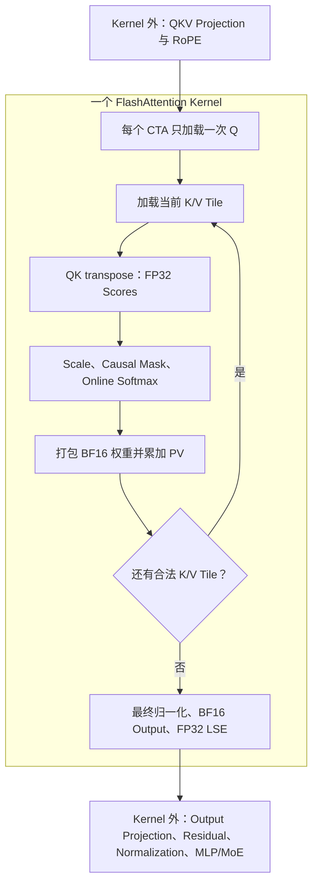

# 用 CUDA 与 PTX 复现 Hopper FlashAttention

本文沿 `sm90_forward.cu` 的 23 节源码顺序，解释一个固定 BF16、D128、Causal Forward Kernel。主体采用 FA3 的 Hopper Pipeline，并结合部分 FA4 软件策略；重点是 Layout、数值状态与异步执行如何配合，而不是逐行翻译代码。

## 01. 计算目标、类型与固定 Tile 规模

对一个 Query Row，Attention 计算：

$$
s_{ij}=q_i^T k_j,\qquad z_{ij}=\sigma s_{ij},\qquad
O_i=\frac{\sum_{j\le i}\exp(z_{ij})v_j}{\sum_{j\le i}\exp(z_{ij})}.
$$

通常采用 $\sigma=1/\sqrt{128}$。这里是等长 Causal Prefill，不是单 Token Decode。正文以 MHA 为例；实际实现也能通过 Query Head 到 KV Head 的映射支持 GQA/MQA。

| Tensor | Shape | Storage |
|---|---|---|
| Q | `[B,T,Hq,128]` | BF16 |
| K、V | `[B,T,Hkv,128]` | BF16 |
| Output | `[B,T,Hq,128]` | BF16 |
| LSE | `[B,Hq,T]` | FP32 |

`B` 是序列数量，`T` 是每条序列的 Token 数，`Hq/Hkv` 是 Query/KV Head 数。LSE 保存 Softmax 分母的自然对数，用紧凑的逐行统计量代替完整 Probability Matrix。



完整的 $T\times T$ Score Matrix 与 Probability Matrix 不会作为中间结果写入 Global Memory。循环中的变量 `O` 实际保存未归一化分子 $U$，`P` 保存未归一化指数权重；直到 Epilogue 才形成 $O=U/\ell$。

固定规模为 `BM=BN=D=128`，但三个轴分别表示 Query Token、Key Token 和 Head Feature，不能混淆。一个 CTA 负责同一 Batch/Head 的 128 个 Query Row；两个 Consumer Warp Group 各计算 64 行并共享 K/V，另一个 Warp Group 负责生产数据。`STAGES=2` 表示时间槽，`GROUPS=8` 表示每 16 列一个 Register Fragment，与 GQA 分组无关。

## 02. Shared Storage 与 Lifetime

理解声明时，需要把三个维度分开：Feature Band、时间槽，以及 Consumer 的行分工。

```cpp
bf16 Q[2][128 * 64];
bf16 K[2 /* stages */][2 /* bands */][128 * 64];
bf16 V[2 /* stages */][2 /* bands */][128 * 64];
```

一个 Feature Band 保存**全部 128 行**的第 0–63 列或第 64–127 列。C0/C1 则按行划分，各负责 64 行；两个 Consumer 都需要读取两个 Band。时间槽保存一个完整 Tile，直到两个 Consumer 都结束读取。

| Storage | 计算方式 | 大小 |
|---|---|---:|
| Q | 2 个 Band × 128 × 64 × 2 bytes | 32 KiB |
| K | 2 个时间槽 × 32 KiB | 64 KiB |
| V | 2 个时间槽 × 32 KiB | 64 KiB |
| Payload 合计 | Q + K + V | 160 KiB |

Q 在整个 CTA 扫描期间不变，因此没有时间上的 Double Buffer。K、V 各自有两个槽：Consumer 使用一个槽时，TMA 可以填充另一个已归还的槽。

```text
Shared Payload 的偏移：
0              32 KiB                96 KiB               160 KiB
| Q: 32 KiB    | K slots: 64 KiB      | V slots: 64 KiB       |
                                    | O: 32 KiB | 未使用     |
                                      仅 Epilogue 使用
```

C++ Union 让 32 KiB 的 Output 暂存区覆盖 V 的起始区域。节省空间的前提是：写 Output 时已经不再需要 V。Union 本身**不会执行同步**。Epilogue 必须先确认两个 Consumer 的最后一次 PV 都结束，再覆盖 V；之后还有一次同步，确保 TMA 读取的是完整 Output。

动态分配额外增加 1023 bytes，让原始指针向上对齐到 1024-byte 边界后仍有完整 Payload 空间。静态 Barrier 另外占用 Shared Memory。官方 Hopper Kernel 的 Shared Storage 组织也采用这种基于 Lifetime 的空间复用。

## 03. 编码五维 Tensor Map

`CUtensorMap` 是交给 TMA 的 Tensor Descriptor，用来描述现有 Global Tensor。Host 函数 `cuTensorMapEncodeTiled()` 把地址、维度、Byte Stride、Transfer Box 和 Shared Memory Swizzle 编码进去；它既不创建替代 Tensor，也不执行搬运。

从连续的 `X[B,T,H,128]` 出发，把 Feature Index 拆成 $f=64u+d$，其中 $u\in\{0,1\}$、$0\le d<64$。Byte Offset 为：

$$
\operatorname{offset}=256THb+256Ht+256h+128u+2d.
$$

| Descriptor Coordinate | Extent | Byte Stride |
|---|---:|---:|
| d | 64 | 2，隐含 |
| token | T | 256H |
| head | H | 256 |
| band | 2 | 128 |
| batch | B | 256TH |

这个 Coordinate 顺序**不代表 Global Stride 从小到大排列**。实际地址由显式 Stride 决定，原始 Tensor Layout 没有改变。

~~~text
Global shape:    [64, T,   H, 2, B]
Transfer box:    [64, 128, 1, 2, 1]
Element stride: [1,  1,   1, 1, 1]
Start:          [0, token, head, 0, batch]
~~~

Box 共覆盖 $64\times128\times2=16384$ 个 BF16，即完整的 32 KiB Tile。例如 `H=8,t=1,h=0,u=1,d=0,b=0` 的 Byte Offset 是 $2048+128=2176$，对应 Token 1、Head 0 的 Feature 64。

为什么拆 D？当前非 Interleave 的 SW128 映射要求最内层 Box 宽度不超过 128 bytes。128 个 BF16 是 256 bytes，拆成两个 64-element Band 后满足约束，数学上的 Head Dimension 仍然是 128。具体限制见 [Tensor Map API](https://docs.nvidia.com/cuda/archive/12.8.1/cuda-driver-api/group__CUDA__TENSOR__MEMORY.html)。

D256 可以表达为四个 Band，但不能只改这个数字：保持现有 Tile 与 Stage 数时，Q/K/V 需要 320 KiB Shared Storage，Output Register 数量也会增加。这里仍固定 D128。

Q/Output Map 使用 Hq，K/V Map 使用 Hkv。混用两者的 Stride，会出现 MHA 正常但 GQA 错误的情况。

## 04. Barrier：Arrival、Transaction Bytes 与 Parity

Pipeline 要避免两种风险：数据尚未搬完就开始读，以及旧数据尚未用完就被覆盖。因此，每个 K/V Slot 都有两类 Barrier。

| Barrier | 完成条件 | 等待者 |
|---|---|---|
| Full | Producer Arrival，加上 32768 bytes TMA 完成 | Consumer |
| Empty | 两个 Consumer 各归还一次 | Producer |

`mbarrier.init.shared::cta.b64` 根据预期 Arrival 数初始化 Shared Memory Barrier。这里 Full 为 1、Empty 为 2，计数的是协议参与者，而不是 CTA 的全部线程。`barrier_address()` 把 Generic Pointer 转成这些 PTX 指令需要的 32-bit Shared Address。

`mbarrier.arrive.expect_tx.release.cta.shared::cta.b64` 同时登记一次 Arrival 和预期 Transaction Bytes。这里用于声明一次 32 KiB TMA 搬运，之后由搬运本身完成这些 Bytes。仅仅发射 TMA，不会让 Full 立即就绪。

`mbarrier.arrive.release.cta.shared::cta.b64` 只登记 Arrival，不增加 Transaction Bytes。这里每个 Consumer 选一个线程，在自己的 WGMMA **确认不再读取该槽之后**归还 Empty。

~~~mermaid
flowchart LR
    E["Empty 完成"] --> T["Producer 登记 Bytes 并发射 TMA"]
    T --> F["Full 完成：Arrival 与 Bytes 都满足"]
    F --> C["C0、C1 读取 Tile"]
    C --> W["各自等待 WGMMA 完成，再归还 Empty"]
    W --> E
~~~

`mbarrier.try_wait.parity.acquire.cta.shared::cta.b64` 等待指定 Parity 对应的 Phase 完成。Phase 表示复用代次，不是 Buffer Index。初始化时 Phase 0 正在进行；等待 Phase 0 是等这一代完成，不是等 Barrier 当前 Parity 等于零。

Helper 先尝试一次，然后携带 `0x989680` 重试。这是 **10,000,000 纳秒的 Suspension Hint**，不是 GPU Cycle，也不是安全 Timeout。无 Hint 的形式也可能挂起，并不等价于非阻塞的 `test_wait`。一次尝试未成功，外层还会继续循环。见 [PTX Wait 语义](https://docs.nvidia.com/cuda/archive/12.8.1/parallel-thread-execution/index.html#parallel-synchronization-and-communication-instructions-mbarrier-test-wait-try-wait)。

Release/Acquire 负责协议中的顺序关系。`"memory"` Compiler Clobber 不是 Hardware Wait；一次 Arrival 也不会自动等待尚未结束的 WGMMA。

## 05. TMA Load 与环形槽推进

PTX 的 `cp.async.bulk.tensor.5d` 指令族根据 Tensor Map 和五个坐标发起异步 Tensor Copy。这里方向是 Global 到 Shared；`mbarrier::complete_tx::bytes` 把 Copy Completion 关联到传入的 Full Barrier。

~~~ptx
cp.async.bulk.tensor.5d.shared::cluster.global
    .mbarrier::complete_tx::bytes.L2::cache_hint
    [destination], [map, {0, token, head, 0, batch}], [barrier], hint;
~~~

上面折行表示同一条指令。`destination` 选择 Shared Slot，Map 选择 Tensor 与 Layout，坐标选择 Global Tile。虽然起点为 Band 0，Box 的 Band Extent 为 2，因此仍搬两个 Band。取 `token=256,head=3,batch=0` 时，逻辑切片是 `X[0,256:384,3,0:128]`。

模板参数 `Query` 选择 L2 Replacement Hint：Q 使用 evict-first，K/V 使用 evict-last。它不会自动选择源 Tensor，源由 Map 决定。这反映了 Q 在 CTA 内使用、K/V 可能跨 CTA 复用的特点，但并不会锁住 Cache Line。

搬运协议可写为：

~~~text
等待 Empty[slot] 的本轮 Producer 代次
向 Full[slot] 登记 Arrival 与 32768 Expected Bytes
发射 Tensor Copy 到该槽
推进 Producer Cursor
~~~

推进只修改状态：

~~~cpp
if (++stage == STAGES) {
    stage = 0;
    phase ^= 1;
}
~~~

| Tile 使用序号 | Slot | Full 等待 Phase |
|---:|---:|---:|
| 0 | 0 | 0 |
| 1 | 1 | 0 |
| 2 | 0 | 1 |
| 3 | 1 | 1 |

推进 Cursor 不代表 Copy 完成，也不会自动释放 Slot。Producer、Consumer 各自维护 Cursor；Empty 还有启动时的预 Arrival，第 20 节再解释。K、V 都采用两个槽，但 Readiness/Release Barrier 相互独立。

## 06. SW128 与 WGMMA Shared Descriptor

TMA 与 WGMMA 需要两种不同的描述信息，来访问同一份数据：

| 对象 | 使用者 | 描述内容 |
|---|---|---|
| `CUtensorMap` | TMA | Global Tensor 与 Transfer Layout |
| 64-bit Shared Descriptor | WGMMA | Shared Operand 地址与 Matrix Layout |

~~~mermaid
flowchart LR
    G["Global Q/K/V"] -->|"Tensor Map + TMA"| S["SW128 Shared Tile"]
    S -->|"WGMMA Descriptor"| R["FP32 Register Accumulator"]
~~~

一个 Band 的每行是 64 个 BF16，即八个 16-byte Chunk。在当前对齐的 Layout 中：

~~~cpp
physical_chunk = logical_chunk ^ (row & 7);
physical_element = row * 64 + (col ^ ((row & 7) << 3));
~~~

| Row | Logical Chunk 0–7 对应的 Physical Position |
|---:|---|
| 0 | 0 1 2 3 4 5 6 7 |
| 1 | 1 0 3 2 5 4 7 6 |
| 2 | 2 3 0 1 6 7 4 5 |
| 3 | 3 2 1 0 7 6 5 4 |

以 Row 3、Column 17 为例，Logical Chunk 是 2，Chunk 内 Index 是 1。XOR 后得到 $2\mathbin{\mathrm{xor}}3=1$，所以 Physical Element Offset 为 $3\times64+1\times8+1=201$，即 402 bytes。Chunk 编号不是 Bank 编号；置换改变 Bank Access Pattern，但每个 Chunk 内的八个 BF16 仍然连续。

WGMMA Descriptor 使用 16-byte 单位编码地址和偏移：

~~~cpp
encode(value) = (value & 0x3ffff) >> 4;
descriptor = encode(shared_start)
           | (encode(leading_bytes) << 16)
           | (encode(1024) << 32)
           | (1ULL << 62);
~~~

最高两位 `01` 选择 SW128。Q/K 采用 K-major，`leading_bytes=16`；V 采用 MN-major，`leading_bytes=16384`，用于跨到第二个 Feature Band。这些字段描述 WGMMA 的 Layout Atom，不能当成普通 C++ 数组 Row Stride。

`advance_descriptor` 使用已经编码的偏移更新低位 Word，同时保留 Layout 字段。第 10 节会推导 QK、PV 不同的步进。Descriptor 只负责解释 Swizzled Data，不会执行物理 Transpose 或重新排列数据。

## 07. WGMMA 的 Fence、Commit、Wait

WGMMA 是异步操作。普通 Register Access 与异步 Matrix Operation 之间需要显式建立顺序；仅仅按照 C++ 源码顺序书写调用并不够。

| 机制 | 一般作用 | 此处用途 |
|---|---|---|
| 带 `+f` / `+r` 的空 asm | 声明 Compiler 可见的 Register Read/Write | 显式表达 Scores、Output、Packed P 的依赖 |
| `wgmma.fence.sync.aligned` | 对先前 Register Access 和后续 WGMMA Access 建立顺序 | 发射前建立 Operand Ordering |
| `wgmma.commit_group.sync.aligned` | 把此前未提交的 WGMMA 划为一组 | 将八步 Native MMA 组成一个 Tile Operation |
| `wgmma.wait_group.sync.aligned N` | 等到最多剩下最新 N 个未完成组 | 先取得 QK，再等 PV 完成后修改 P/O |

空 asm 不做计算。`+f` 表示可读写 FP32 Register，`+r` 表示可读写 Integer Register；`"memory"` 限制 Compiler 移动内存操作。它们都不能替代 Hardware Completion Wait。

假设按这个顺序提交：

~~~text
commit A: QK(next)
commit B: PV(current)

wait<1> → A 已完成；B 可能仍在执行
          可以读 next_scores、归还 K

wait<0> → A、B 都完成
          可以覆盖 P、归还 V、缩放 O
~~~

数字表示 Pending Group 上限，不是 Group ID。A 完成不代表 B 完成；反过来，第一次 Wait 返回时 B 也可能已经结束。这个安排提供 Overlap 的机会，而不是保证某个固定时间关系。

Full Barrier 与 WGMMA Wait 回答的是两个不同问题：**TMA 是否已经写好输入？**以及**Matrix Operation 是否已经读完输入、产出结果？** Consumer 必须遵守两者才能安全复用 Shared Slot。CUTLASS 的 [Hopper WGMMA Wrapper](https://github.com/NVIDIA/cutlass/blob/7127592069c2fe01b041e174ba4345ef9b279671/include/cute/arch/mma_sm90_gmma.hpp) 也封装这些硬件操作。

## 08. QK WGMMA：Shared/Shared Operand 与 Register 分工

`wgmma.mma_async.sync.aligned.m64n128k16.f32.bf16.bf16` 让一个 128-thread Warp Group 协同执行 BF16 Matrix Product，并进行 FP32 Accumulation。SS 形式的两个输入都是 Shared Descriptor。这里一次计算 64 个 Query、128 个 Key 在 16 个 Feature 上的部分得分：

$$
S_{64\times128}\leftarrow Q_{64\times16}K^T_{16\times128}+\text{optional }S.
$$

缩短重复的 Operand 列表后，控制参数更清楚：

~~~ptx
wgmma.mma_async.sync.aligned.m64n128k16.f32.bf16.bf16
    {64 FP32 registers}, desc_Q, desc_K, ScaleD, 1, 1, 0, 0;
~~~

| Operand | 此处含义 |
|---|---|
| 64 个 FP32 Register | 当前线程的 Output Fragment，不是整个矩阵 |
| desc_Q、desc_K | 两个 64-bit Shared Descriptor |
| ScaleD | 0 覆盖 Accumulator；1 保留并累加 |
| 1、1 | 两个输入都不取负 |
| 0、0 | Q、K 的 K-major Operand Layout Selector |

指令的 Reduction Dimension K=16 表示 **Feature**，不是 16 个 Key Token。`ScaleD` 不是 Attention Scale。Layout Selector 让硬件按指定方式解释 Operand，并不会对 Global Array 执行 Transpose。

### 从 CTA 到 Lane

~~~text
CTA：128 Query Row × 128 Key Column
  C0：Row 0–63       C1：Row 64–127
  每个 Consumer：四个 Warp，各负责 16 Row × 128 Column
  每个 Warp：八个四 Lane 的 Quad
  每个 Lane：两行 × 32 列 = 64 个 FP32 值
~~~

在一个 Consumer 内：

~~~cpp
r0 = warp * 16 + lane / 4;
r1 = r0 + 8;
c  = g * 16 + 2 * (lane & 3);  // g = 0..7
~~~

固定 Warp 0、Quad 0、g=0：

| Lane | Row 0 与 Row 8 中分别持有的 Column |
|---:|---|
| 0 | 0、1、8、9 |
| 1 | 2、3、10、11 |
| 2 | 4、5、12、13 |
| 3 | 6、7、14、15 |

对任意 Lane，Slot 0/1/4/5 对应 r0 的 c/c+1/c+8/c+9 列；Slot 2/3/6/7 对应 r1 的相同列。g 每增加 1，全部列号加 16。因此 g 是 Register Column Group，不是 Head，也不是 Warp Group。

这个硬件 Accumulator Layout 决定后面的 Quad Reduction 与 BF16 Packing。若把每个 Lane 的 Fragment 误当成连续 8×8 Tile，Row Statistics 与 Output Store 都会错误。

## 09. PV WGMMA：Register/Shared Operand

RS 形式的 `wgmma.mma_async` 从 Register 读取 A，从 Shared Memory 读取 B。这里直接把 Softmax 连接到第二次 GEMM：

$$
U_{64\times128}\leftarrow U_{64\times128}
+\widetilde P_{64\times16}V_{16\times128}.
$$

$\widetilde P$ 是转换为 BF16 的未归一化指数权重。它保留在 Register 中，因此 Softmax 与 PV 之间不需要把 Probability Tile 写入 Shared Memory。

~~~ptx
wgmma.mma_async.sync.aligned.m64n128k16.f32.bf16.bf16
    {64 FP32 registers}, {A0, A1, A2, A3}, desc_V, 1, 1, 1, 1;
~~~

| Operand/Control | 含义 |
|---|---|
| A0–A3 | 每线程四个 32-bit Register，每个打包两个 BF16 权重 |
| desc_V | V 的 Shared Descriptor |
| 后面第一个 1 | 保留并累加 U |
| 接下来两个 1 | A、B 都不取负 |
| 最后一个 1 | B 的 MN-major Layout Selector |

与 SS 不同，RS 没有 A Transpose Selector，因为 A 已经采用规定的 Register Layout。128 个线程的四个 Packed Register 共提供 $128\times4\times2=1024$ 个 BF16，正好对应 64×16 的 A Operand。

| 轴 | QK | PV |
|---|---|---|
| M=64 | Query Row | Query Row |
| N=128 | Key Token | Output Feature |
| K=16 | 参与 Reduction 的 Feature | 参与 Reduction 的 Key Token |

V 的逻辑形状是 `V[key,feature]`。MN-major Descriptor 让 WGMMA 直接读取已有的 TMA-swizzled Storage，无须物理 Transpose；它并没有把数学运算改成 $PV^T$。

每条 PV 指令都执行 Accumulation，所以 U 从零开始，跨多个 KV Tile 保留。它可能随 Softmax Exponent Base 改变而重缩放，但直到 Epilogue 才除以分母。

## 10. 发射完整的 QK / PV Tile

`issue_qk` 与 `issue_pv` 把 Native K16 指令组合成完整的 128-wide Reduction。每个 Helper 发射八步 MMA，再提交为一个异步 Group；何时 Wait 由调用者决定。

QK 的两个 D64 Band 分别提供四步：

~~~text
Operand Fence
Band 0:
    Step 0: S = Q[0:16] × K[0:16]^T
    Step 1..3: 累加 Feature 16:32、32:48、48:64
Band 1:
    Step 0..3: 累加 Feature 64:80、...、112:128
Commit 一个 QK Group
~~~

Q 的 Shared Base 还加上 `consumer * 64 * HALF_D`，选择该 Consumer 的 64 个 Query Row。两个 Consumer 使用相同的 K Descriptor。

Descriptor Increment 已经采用 16-byte 单位。QK 每步前进 16 个 BF16 Feature，即 $16\times2/16=2$ 个编码单位。Helper 为每个 Band 构建一次 Base，然后加 `k*2`，不必反复生成全部字段。

PV 每一步则消耗 16 个 Key Token：

~~~text
Operand Fence
for k in 0..7:
    U += P[k] × V[keys 16*k : 16*k+16, all 128 features]
Commit 一个 PV Group
~~~

在 D64 Band 内前进 16 个 V Row，需要跨过 $16\times64\times2=2048$ bytes，即 128 个编码单位。MN-major Descriptor 已经描述两个 Feature Band，因此不需要分别执行 V0、V1 两个循环。

| 项目 | QK | PV |
|---|---:|---:|
| 每个 Tile 的 Native Instruction 数 | 8 | 8 |
| 每步 Encoded Increment | 2 | 128 |
| 第一条指令保留 Accumulator？ | 否 | 是 |
| Reduction Axis | 128 个 Feature | 128 个 Key Token |

这些是一个 KV Tile 内的 Reduction Step，不是八个不同时间的 Tile。若每一步后都 Wait，就失去了把整个 QK/PV Group 与其他工作形成 Pipeline 的机会。

## 11. Probability Packing 与 Base-2 Exponential

同一组 Score Register 在数据流中会改变含义：

~~~mermaid
flowchart LR
    A["QK：FP32 Dot Product"] --> B["Online Softmax：FP32 指数权重"]
    B --> C["pack_probabilities：uint32 中的 BF16 Pair"]
    C --> D["RS WGMMA：FP32 分子 U"]
~~~

`__floats2bfloat162_rn(a,b)` 使用 Round-to-nearest-even 把两个 FP32 转成 BF16 并打包：a 放低 16 bits，b 放高 16 bits。随后把 Bit Pattern 作为 32-bit Integer Operand 传入，**不是把数值转换成整数**。

~~~text
对每个 g：
    P[g][0] = pack_BF16(scores[g][0], scores[g][1])
    P[g][1] = pack_BF16(scores[g][2], scores[g][3])
    P[g][2] = pack_BF16(scores[g][4], scores[g][5])
    P[g][3] = pack_BF16(scores[g][6], scores[g][7])
~~~

以 Lane 0、g=0 为例，四个 Pair 分别是 Row 0 的 Column 0/1、Row 8 的 Column 0/1、Row 0 的 Column 8/9、Row 8 的 Column 8/9。这正好符合下一步 K16 PV 所要求的每线程 A-Operand Layout，不需要跨 Lane Shuffle。

一个可精确表示的例子：1.0 与 2.0 的 BF16 分别是 `0x3f80`、`0x4000`，打包后的 Register Bit Pattern 为 `0x40003f80`。一般权重会产生舍入误差，FP32 Accumulation 不会恢复被舍去的精度。

另一个 Helper 使用 `ex2.approx.ftz.f32`：计算近似 FP32 Base-2 Exponential，并对 Subnormal 采用 Flush-to-zero 处理。这里用于指数权重与 Rescaling Factor。令 $\lambda=\sigma\log_2(e)$，则：

$$
\exp(\sigma(s-m))=2^{s\lambda-m\lambda}.
$$

Softmax 先用 FMA 构造指数，再调用这个 Helper。使用 Base 2 不改变目标 Softmax 数学函数，但实际浮点计算仍然存在近似误差。

## 12. Online Softmax 上半：Coordinate、Causal Mask 与 Maximum

`online_softmax<First,Masked>` 的前半段寻找候选 Exponent Base：根据 Accumulator Layout 恢复矩阵坐标，屏蔽 Future Token，然后计算每行 Maximum。

`First` 表示当前 Consumer 处理的第一个 KV Tile，不是 Token 0。`Masked` 在编译期决定是否需要逐元素 Causal Comparison。BM/BN 相等时，Reverse Traversal 从 Diagonal Tile 开始，只访问更早的 Tile：

| Query Block \ Key Block | 0 | 1 | 2 | 3 |
|---|---|---|---|---|
| 0 | Mask | Skip | Skip | Skip |
| 1 | Full | Mask | Skip | Skip |
| 2 | Full | Full | Mask | Skip |
| 3 | Full | Full | Full | Mask |

注意 (0,0) 也是三角区域，不能标成 Full。Skip Block 不加载也不计算；只有 Diagonal 需要逐元素 Mask，之前的 Block 则进入编译后的 Unmasked Loop。

坐标来自第 08 节的映射：

~~~text
query = query_start + r0 或 r1
key   = key_start + c、c+1、c+8 或 c+9
if key > query:
    score = -FLT_MAX
~~~

例如 Query Token 136 对应从 128 开始的 Key Tile，只有 Key 128–136 合法。即使 Key 137 的 Score 很大，也必须先屏蔽，再做 Maximum Reduction。

每个 Lane 持有每行的 32 列。代码采用四条独立 Maximum Chain，先做 Tree Merge，再在四 Lane 的 Quad 内通过 XOR 1、XOR 2 交换结果。假设 Local Maximum 为：

~~~text
Lane:          0  1  2  3
Local Max:     4  7  3  6
XOR 1 Max:     7  7  6  6
XOR 2 Max:     7  7  7  7
~~~

完整的 Shuffle Participation Mask 不代表对 32 个 Lane 做归约：XOR 1/2 只改变 Lane Index 最低两位。其他 Quad 对应其他行，不能混入。

后续 Tile 会在 Quad Reduction 前，把旧 Exponent Base 合并进候选值。四条 Chain 缩短串行依赖，并不是省去所有必要比较。当前有限负数 Sentinel 适用于这里的合法 Causal Row，因为每行至少有一个允许访问的 Key。

## 13. Online Softmax 下半：Exponent Base、权重与分母

变量 `row_max` 保存的是 **Raw-score 单位下实际采用的 Exponent Base**。采用 Threshold Update 后，它不一定等于迄今出现过的最大 Score。

令基准为 $m$，$\lambda=\sigma\log_2(e)$，对应的 Base-2 基准为 $b=m\lambda$。权重与状态表示为：

$$
p_j=2^{s_j\lambda-b},\qquad
\ell=\sum_jp_j,\qquad U=\sum_jp_jv_j.
$$

从 b 换到 b' 时，需要 $\alpha=2^{b-b'}$：

$$
\ell'=\alpha\ell+\sum_{\text{new}}p'_j,\qquad
U'=\alpha U+\sum_{\text{new}}p'_jv_j.
$$

分子、分母必须使用同一个 Base。在精确算术下，选择不同 Base 不改变两者的比值。

### 为什么差值不超过八个 Log2 Unit 时保留旧 Base？

实现逻辑是：

~~~text
candidate = max(old_base, current_tile_max)
change = (old_base - candidate) * scale_log2
if not first_tile and change >= -8:
    selected_base = old_base
    factor = 1
else:
    selected_base = candidate
    factor = first_tile ? 1 : exp2(change)
~~~

保留 Base，就同时保留旧分子、分母的 Scale。这里**不是换了 Base，却把很小的 Rescaling Factor 近似为 1**；而是根本没有切换 Base。因此新权重可以大于 1，在阈值范围内最高约为 $2^8=256$。

用 Base-2 坐标举例：原来 $b=10,\ell=3,U=6$。新来的两个 Score 为 12、11，对应标量 Value 为 10、2。此时保留 Base 10：

$$
p_1=4,\quad p_2=2,\quad
\ell'=3+4+2=9,\quad U'=6+4(10)+2(2)=50.
$$

结果为 $50/9$。如果立即换成 Base 12，会得到 $\ell'=2.25,U'=12.5$，比值相同。若候选 Base 增加到 20，差值超过八，旧状态就要乘 $2^{-10}$。

Threshold 用来减少重复 Output Rescaling，同时限制 Base 落后新 Maximum 的程度。它是软件策略，不是 BF16 Exponent Bit 数的规定。[官方 FA4 Softmax](https://github.com/Dao-AILab/flash-attention/blob/94e22c906678e5483fa0e9e24d8e787bc2c0ed4c/flash_attn/cute/softmax.py) 中可以找到对应的 Thresholded-base 策略；这里的 8 是本 Kernel 的取值。

最后，Scores 原位变为指数权重。四条独立 FP32 Addition Chain 产生每个 Lane 的 Local Sum。局部分母经过 Rescale 后累加新权重，但暂时不把四个 Lane 的 Sum 合起来；第 15 节才进行最终 Reduction，避免每个 Tile 都做通信。Output Rescaling 单独处理，因为 PV 可能仍在写 U。

## 14. 对 Output Numerator 执行 Rescale

`scale_output` 把现有 FP32 Numerator 换算到选定的 Exponent Base。它既不是乘 Attention Scale，也不是最终 Normalization。

~~~text
if (!warp_any(factor[0] != 1 || factor[1] != 1))
    return;
for each g and slot:
    output[g][slot] *= factor[(slot & 2) >> 1];
~~~

每个 Lane 持有两行的部分数据。Slot Index 的 Bit 1 决定对应哪一行：

| Slot | Row | Factor |
|---|---|---|
| 0、1、4、5 | r0 | factor[0] |
| 2、3、6、7 | r1 | factor[1] |

例如一个 Register Group：

~~~text
before: [1024, 2048, 10, 20, 3072, 4096, 30, 40]
factor: [r0 使用 1/1024，r1 使用 1]
after:  [   1,    2, 10, 20,    3,    4, 30, 40]
~~~

实现中的 `__any_sync` 让 Skip Decision 在整个 Warp 内一致。如果所有对应行都保留旧 Base，就跳过全部 Output Multiplication。只要某一行改变，整个 Warp 都执行循环；未改变的行只是乘 1。

要区分三种 Scale：

| 数值 | 用途 |
|---|---|
| $\sigma=1/\sqrt D$ | 固定的 Attention-logit Scale |
| $\alpha=2^{(m_{\rm old}-m_{\rm new})\lambda}$ | Exponent Base 改变时的动态修正 |
| $1/\ell$ | 全部 KV Tile 结束后的最终 Normalization |

只要中间算术始终有限，固定 Base 在数学上也足够。但实际可能在最终除法之前就发生 Overflow 或严重 Underflow，因此需要在线调整。最后只修改 `row_max`，既不能修复已经无效的中间值，也会让 LSE 与保留的 Sum 不一致。

在异步循环中，必须等当前 PV 完成后才能 Rescale，这样新加入的贡献和旧 Numerator 才会一起得到修正。

## 15. 完整 Row Sum、Reciprocal 与 LSE

最后一次 Softmax 更新结束后，每个 Lane 仍只保存该行分母的一部分。`finalize_rows` 合并这些 Partial Sum，计算 Reciprocal，并生成 LSE。

~~~text
对 Lane 对应的两行分别执行：
    sum += shuffle_xor(sum, 1)
    sum += shuffle_xor(sum, 2)
    inverse = approximate_reciprocal(sum)
    LSE = retained_raw_base * attention_scale + log(sum)
~~~

若四个 Lane 的 Local Sum 为 [1,2,3,4]：

| 步骤 | Lane 0 | Lane 1 | Lane 2 | Lane 3 |
|---|---:|---:|---:|---:|
| Local | 1 | 2 | 3 | 4 |
| XOR 1 Addition | 3 | 3 | 7 | 7 |
| XOR 2 Addition | 10 | 10 | 10 | 10 |

这里不需要再次做 Maximum Reduction，因为四个 Lane 已经采用相同的 Base。现在完整 Sum 也复制到每个 Lane，便于分别归一化各自的 Output Column。

PTX 指令 `rcp.approx.ftz.f32` 计算近似 FP32 Reciprocal，并对 Subnormal 采用 Flush-to-zero。这里把最终正分母转换成可重复使用的乘数，避免为每个 Output Element 单独执行除法。同一 Quad 的 Lane 会为各自持有的同一行统计量重复计算 Reciprocal。

为什么 LSE 不是简单的 `log(sum)`？因为保存的分母已经减去 Base：

$$
\ell=\sum_j e^{\sigma(s_j-m)},\qquad
\operatorname{LSE}=\log\sum_j e^{\sigma s_j}
=\sigma m+\log\ell.
$$

例如 $m=4,\sigma=0.5,\ell=10$，则 LSE 为 $2+\log(10)\approx4.302585$。这里是自然对数，尽管前面的 Exponential 使用 Base 2。

即使保留的 Base 低于真实 Maximum，只要它与 Sum 使用的 Base 一致，公式仍然成立。Finalization 不读取 U，因此可以在最后一次 PV 尚未完成时执行；真正的 Output Normalization 仍必须等待 PV。

## 16. Output Normalization、stmatrix 与 LSE Store

`store_output` 对每个 FP32 Accumulator Element 做归一化，转成 BF16，并暂存到 Shared Memory。它本身不执行最后的 Global TMA Store。

~~~mermaid
flowchart LR
    U["FP32 U Register"] --> N["乘 Row Reciprocal"]
    N --> P["BF16 转换与 Pair Packing"]
    P --> S["stmatrix：Register 到 SW128 Shared O"]
    S --> T["之后：一次 TMA Store 到 Global O"]
~~~

PTX 指令 `stmatrix.sync.aligned.x4.m8n8.shared.b16` 让整个 Warp 协作，把四个 8×8、16-bit Element 的矩阵存入 Shared Memory。这里用于将 WGMMA Accumulator 排布转成 TMA 所需的 Shared Output Layout。

固定一个 Warp 与 g，四个矩阵组成 16×16 区域：

~~~text
                 Column 0–7    Column 8–15
Row 0–7          Matrix 0      Matrix 2
Row 8–15         Matrix 1      Matrix 3
~~~

每个 Lane 提供四个 Packed Register，整个 Warp 共 $32\times4\times2=256$ 个 BF16，正好覆盖 16×16 区域。八次 g 迭代覆盖全部 128 个 Output Feature。

**Data Ownership 与 Address Provision 是不同的映射。** Lane 通过 `lane/4` 持有 Accumulator Row，却通过 `lane&15` 提供 stmatrix Row Address。指令会把整个 Warp 提供的数据分配到对应矩阵，并不是每线程执行四次普通 Store。

目标地址计算为：

~~~cpp
row = consumer_row_offset + warp * 16 + (lane & 15);
column = g * 16 + (lane >> 4) * 8;
band = column / 64;
offset = row * 64 + ((column % 64) ^ ((row & 7) << 3));
~~~

例如 Row 3、Band 内 Column 8 的 Swizzled Element Offset 为 $192+(8\mathbin{\mathrm{xor}}24)=208$。指令本身没有额外 SW128 Flag，必须让地址计算与后续 Tensor Map 一致。

LSE 使用普通 Global Store。每个 Quad 只有第一个 Lane 写两行统计量，避免四个重复 Writer。线性 Index 为 `(batch*Hq+head)*T+token`，与 Output 的 `[B,T,Hq,D]` Layout 不同。后面会解释何时可以安全覆盖与 O 重叠的 V Storage。

## 17. Kernel 入口、Shared Alignment 与初始化

前面定义了各个功能块，现在主 Kernel 开始把它们连接起来。首先准备 Storage 与同步状态。

~~~text
对齐 Dynamic Shared Payload
    → 一个线程 Prefetch Descriptor 并初始化 Barrier
    → 向 Async Proxy 发布初始化结果
    → CTA Synchronization
    → 确定 Producer 与 Consumer Group
~~~

Dynamic Allocation 最初声明为 16-byte Alignment，随后显式向上对齐：

~~~cpp
aligned = (shared_address + 1023) & ~1023;
~~~

例如 Shared Address 1040 会变成 2048。即使 Compiler 知道 C++ 类型的 Alignment，运行时地址也必须真正满足对齐；多分配的 1023 bytes 用于覆盖最坏调整距离。静态的 64-bit Barrier 另外按 8 bytes 对齐。

`prefetch.tensormap` 将 Tensor Map Descriptor 预取到硬件的 Descriptor Cache 路径。这里 Thread 0 预取 Q/K/V/O Map，**不是加载矩阵数据**。`__grid_constant__` 参数提供 Grid-constant Descriptor 对象，其地址可供 TMA 使用。

Thread 0 初始化：

| Barrier | 数量 | 每个 Expected Arrival |
|---|---:|---:|
| query_full | 1 | 1 |
| k_full、v_full | 各 2 个 Slot | 1 |
| k_empty、v_empty | 各 2 个 Slot | 2 |

`fence.proxy.async.shared::cta` 在普通 Shared Memory Operation 与 Async Proxy 之间建立顺序；这里让初始化后的 Barrier State 在异步使用前可见。随后 `__syncthreads()` 让整个 CTA 一起通过初始化阶段。

线程角色固定为：

| CTA Thread Index | group | 角色 |
|---|---:|---|
| 0–127 | 0 | Producer Warp Group |
| 128–255 | 1 | Consumer C0：前 64 个 Query Row |
| 256–383 | 2 | Consumer C1：后 64 个 Query Row |

局部 `tid=threadIdx.x%128` 是 Warp Group 内的 Index，不是 CTA Thread Index。因此在 Producer 分支返回前，`tid==0` 对应三个不同线程。计算 Barrier Arrival 数时必须区分它们。

## 18. 静态 CTA Mapping 与 GQA Head 选择

一个 CTA 计算一个 Batch、一个 Query Head、一个 128-row Query Tile。映射在同一个 Head Section 中，把较长的 Causal Task 分配给较小的逻辑 Block Index。

~~~text
query_blocks = ceil(T / 128)
section_tiles = section_heads * query_blocks
section, local = divmod(blockIdx.x, section_tiles)

query_block = query_blocks - 1 - local / section_heads
head_batch = section * section_heads + local % section_heads
batch, head = divmod(head_batch, Hq)
kv_head = head / (Hq / Hkv)
~~~

伪代码中的除法都是 Integer Division。`section_heads` 由 Host 提供，第 23 节会根据 Working-set Budget 推导它。

取一个小例子：T=512、Hq=8，假设传入的 Section Size 为 2 个 Head。在 Section 0 内：

| blockIdx.x | Query Block | Query Row | Query Head |
|---:|---:|---|---:|
| 0 | 3 | 384–511 | 0 |
| 1 | 3 | 384–511 | 1 |
| 2 | 2 | 256–383 | 0 |
| 3 | 2 | 256–383 | 1 |
| 6 | 0 | 0–127 | 0 |
| 7 | 0 | 0–127 | 1 |

后面的 Query Block 拥有更多合法 Key，工作量更大。把它们放到较早的逻辑 Index，是一种 Longest-processing-time 风格策略；把相邻 Head 放在一起也有利于 K/V Locality。这是静态映射，不是 Persistent Task Queue，也不保证硬件严格按 Index 执行。

Head Sharing 与 Tile Scheduling 是独立的问题：

| 模式 | Hq | Hkv | 映射 |
|---|---:|---:|---|
| MHA | 8 | 8 | Query Head h 使用 KV Head h |
| GQA | 8 | 2 | Query Head 0–3 使用 KV 0，4–7 使用 KV 1 |
| MQA | 8 | 1 | 全部 Query Head 使用 KV 0 |

例如 GQA 的 Q Head 5 仍使用自己的 Q/Output 地址，但通过 Hkv 对应的 Stride 读取 KV Head 1。当前固定 Shape 可以整除 Head Section；这里不是通用的 Ragged-head Scheduler。

## 19. Producer：Q 加载一次，K 提前一个 Tile

Producer Warp Group 执行 `setmaxnreg.dec.sync.aligned.u32 24`。这条 PTX 降低每线程 Register Allocation，把 Register 资源留给计算量较大的 Consumer；它不搬运矩阵数据。全部 Producer 线程参与 Allocation 调整，但只有局部 tid 0 发射 TMA Request。

Producer 只加载一次 Q，先准备 Diagonal K Tile，然后逆序遍历合法 Key：

~~~text
登记 Q Bytes；发射 Q Copy
等待 K Slot 0 Empty；登记 K Bytes；发射 K[q]

for i = q down to 0:
    if i > 0:
        等待下一个 K Slot Empty
        登记 Bytes；向下一个 Slot 发射 K[i-1]
    等待当前 V Slot Empty
    登记 Bytes；向当前 Slot 发射 V[i]
    推进 Slot 与 Phase
~~~

以 Q384–511、q=3 为例，Issue Sequence 为：

~~~text
Q, K3, K2, V3, K1, V2, K0, V1, V0
~~~

这是发射顺序，不是实测 Completion Timeline。提前一块 K，是为了在 PV(current) 前准备 QK(next) 的输入，与 Consumer Pipeline 对应。

| Logical Tile | K Slot | V Slot | Full Phase |
|---:|---:|---:|---:|
| 3 | 0 | 0 | 0 |
| 2 | 1 | 1 | 0 |
| 1 | 0 | 0 | 1 |
| 0 | 1 | 1 | 1 |

同一个 Logical Tile 的 K/V 使用对应 Slot，但释放时间不同：K 在 QK 完成后就可以复用，V 则要保留到 PV 完成。独立的 Empty Barrier 保证这两种 Lifetime 不会混淆。

Q 通过 `tma_load<true>` 选择 Cache Hint，K/V 使用默认 Hint。Q 没有 Empty Recycling Loop，因为当前 CTA 不会替换自己的 Q Tile。

发射结束后，Producer 分支返回。Consumer 一直在并发执行，并不是等 Producer 全部循环结束后才开始，所以后续 Named Barrier 只计入 256 个 Consumer 线程。这种 K-next/V-current 次序对应 [官方 Hopper Mainloop](https://github.com/Dao-AILab/flash-attention/blob/94e22c906678e5483fa0e9e24d8e787bc2c0ed4c/hopper/mainloop_fwd_sm90_tma_gmma_ws.hpp) 的 Load Pipeline。

## 20. Consumer Prologue：启动协议与首块 QK

Consumer 执行 `setmaxnreg.inc.sync.aligned.u32 240`，增加 Register Allocation，用于 Scores、P、U 和 Row Statistics。这里是分配额度，不代表每个线程恰好有 240 个 Live Value。

接下来有两个不同的启动动作。首先，C0 的全部 128 个线程执行 `bar.arrive 1,256`，为 Named Scheduling Barrier 注入初始 Arrival。`bar.arrive` 只登记、不等待；后面的 `bar.sync` 则登记并等待。这些 Named Barrier 协调 Consumer 轮次，不负责 TMA Byte Completion。

其次，**每个** Consumer 选一个线程，对全部 K/V Empty Barrier 各 Arrival 一次。两次 Arrival 完成最初的 Empty Phase，让 Producer 可以填充尚未使用的槽。这个动作发生在等待 Q 之前，避免启动时形成循环等待。

~~~text
C0：预先到达 Scheduling Barrier 1
C0 Leader + C1 Leader：释放全部初始 Empty Slot
两个 Consumer：等待 query_full
~~~

在贯穿例子中，C0 负责 Q384–447，C1 负责 Q448–511。各自创建清零的 U、Local Row Sum、初始负 Base，以及 Packed-P 数组。U 需要清零，因为 PV 总是累加；Score Register 则由第一条 QK 指令覆盖。

Prologue 随后建立第一个 Probability Tile：

~~~text
等待第一个 K Full
发射 QK(diagonal)；wait<0>
归还本 Consumer 对 K 的使用
online_softmax<First=true, Masked=true>
打包 P
记住当前 V Slot
将 K Cursor 推进到下一个 Tile
~~~

Full Wait 防止读取尚未完成的 TMA 数据；WGMMA Wait 防止使用尚未完成的 Score。QK 完成后，Softmax 不再需要 Shared K，因此可以提前归还。

| Prologue 结束时的状态 | Query Block 3 的情况 |
|---|---|
| P | P3，可以用于 PV |
| row_sum | 已包含 Tile 3 权重 |
| U | 仍为零 |
| value_stage | V3 所在 Slot |
| stage | K2 对应 Slot |

最初的 QK 不经过 Steady-state Turn-taking Barrier；初始 Arrival 是为后面的交替调度准备的。此时还没有执行 PV：主循环需要补上 P3V3；若只有一个合法 Tile，则由 Drain 阶段直接完成。

## 21. Consumer Steady State：交接、Overlap 与延迟 Rescale

Prologue 已经准备好 P，但对应的 PV 尚未完成。因此，每轮 Steady-state Loop 同时处理**两个不同的 Logical Tile**：下一块的 QK，以及当前块的 PV。

| Query Block 3 的阶段 | 新 Scores | Output Contribution | 新准备的权重 |
|---|---|---|---|
| Prologue | QK3 | — | P3 |
| Iteration 1 | QK2 | P3V3 | P2 |
| Iteration 2 | QK1 | P2V2 | P1 |
| Iteration 3 | QK0 | P1V1 | P0 |
| Drain | — | P0V0 | — |

完整依赖链为：

~~~text
C0 等待下一个 K Full
等待本 Consumer 的 Scheduling Turn
发射并 Commit QK(next)
C0 等待当前 V Full
发射并 Commit PV(current)
通知另一个 Consumer

wait<1> → 归还 K → Softmax(next)
wait<0> → 归还 V → 打包下一份 P → Rescale U
推进 K/V Cursor
~~~

### Consumer 之间的 Handoff

`bar.sync id,256` 向 Named CTA Barrier 登记 Arrival 并等待；`bar.arrive id,256` 只登记、不等待。这里组成交替的 Issue Permission：

| Consumer | group | 等待 | 通知 |
|---|---:|---:|---:|
| C0 | 1 | Barrier 1 | Barrier 2 |
| C1 | 2 | Barrier 2 | Barrier 1 |

稳态中，一组 128 个 Arrival 线程与另一组 128 个 Wait 线程共同满足计数。只有 C0 直接等待 K/V Full，再通过 Handoff 把 Readiness Ordering 传给 C1。C1 并非忽略数据就绪，而是通过协议间接取得它。两组仍需分别等待自己的 WGMMA 完成，并各自归还 Shared Slot。

### Consumer 内部的 Overlap

QK(next) 先于 PV(current) Commit。因此，`wait<1>` 返回时 Next Scores 已可读取，而 PV 可能仍 Pending。此时就能归还 K，并对完成的 Scores 执行 Softmax。

~~~mermaid
flowchart TD
    A["先 Commit QK(next)，再 Commit PV(current)"] --> B["等待至最多剩一个 Pending Group"]
    B --> C["QK 完成：归还 K，计算 Softmax(next)"]
    B --> D["PV 可能继续异步执行"]
    C --> E["等待全部 WGMMA Group"]
    D --> E
    E --> F["归还 V、打包下一份 P、Rescale U"]
~~~

图中表示合法依赖，不是实测执行时长。`next_scores` 单独保存新的指数权重，让旧 Packed P 在 PV 读取期间保持不变。在 `wait<0>` 之前，不能覆盖 P，也不能修改 U。

### 为什么延迟 Rescale？

新 Softmax 可能选择新的 Base，但当前 PV 仍使用旧 Base 下的 P。正确更新是：

$$
U_{\rm new\ base}=\alpha\left(U_{\rm old}+P_{\rm current}V_{\rm current}\right).
$$

例如 Base-2 坐标下，旧 Base 为 10，新 Base 为 20，则 $\alpha=1/1024$。旧 U 为 2048，当前 PV 增加 1024，正确结果是 $(2048+1024)/1024=3$。若先 Rescale，再加旧 Base 下的贡献，就会错误地得到 $2+1024=1026$。

分母可以提前更新，因为 PV 不访问它。分母已经包含新准备的 Tile，而 U 暂时落后一次 PV；Drain 会在最终 Normalization 前让两者进度一致。

打包 P(next) 后，`value_stage=stage` 把它关联到对应的 V，再推进 `stage` 选择后续 K。这样 P2 才会配 V2，而不是 V3。主循环保留 `unroll 1`，避免重复展开庞大的 Instruction Body。

## 22. Pipeline Drain 与 V/O Lifetime 交接

Steady-state Loop 结束后，最后一份 P 已经准备好，但还没有乘 V。在贯穿例子中，还欠 P0V0。Drain 完成这一步，不再尝试构造不存在的 Next Tile。

~~~text
等待最后一个 V Full
发射最后一次 PV
在 PV 可能执行期间完成 Row Sum、Reciprocal、LSE
wait<0>
归还最后一次 V 使用
同步两个 Consumer
归一化并写入 BF16 Shared O
向 Async Proxy 发布 Shared O
再次同步两个 Consumer
一个线程发射 Output TMA Store
~~~

Final Row Statistics 不读取 U，所以能与最后一次 PV 重叠。但 `store_output` 需要读取 U，必须放在 Completion Wait 之后。

### 为什么需要两次 Consumer Barrier？

两次都使用 `bar.sync 3,256`，但保护不同的 Lifetime Boundary：

| Barrier 位置 | 必须完成什么？ | 之后可以做什么？ |
|---|---|---|
| 写 Shared O 之前 | 两个 Consumer 最后一次读取 V | 通过 Union 覆盖 V |
| TMA 读 Shared O 之前 | 全部 Output Write 与 Proxy Fence | 读取完整 Output Tile |

一个 Consumer 的局部 `wait<0>` 不会等待另一个 Consumer。缺少第一次 Barrier，快的一组可能覆盖慢的一组仍在读取的 V；缺少第二次，选定的 TMA Issuer 可能读到尚未写完整的 O。

`fence.proxy.async.shared::cta` 让普通 Shared Output Write 与执行 TMA 的 Async Proxy 建立顺序。第二次 Barrier 汇合已经执行 Fence 的两个 Consumer；单独的 Fence 或 Warp-level stmatrix 同步都不能代替这个跨 Consumer Rendezvous。

### 最后的 Store 指令

`cp.async.bulk.tensor.5d.global.shared::cta.tile.bulk_group` 发起 Shared-to-global Tensor Copy。这里 O_map 把 Swizzled 128×128 Shared Tile 映射回 `O[batch,query_start:query_start+128,head,:]`。

~~~ptx
cp.async.bulk.tensor.5d.global.shared::cta.tile.bulk_group
    [O_map, {0, start, head, 0, batch}], [shared_O];
cp.async.bulk.commit_group;
cp.async.bulk.wait_group.read 0;
~~~

`commit_group` 提交此前发射的 Bulk Copy。`wait_group.read 0` 等待已提交操作读完 Shared Source，保护 CTA 退出前的源数据 Lifetime。它不代表其他任意 GPU 线程可以无须正常 Kernel/Stream Ordering 就读取 Global O。这些 Bulk-copy Group 与 WGMMA Group 是不同机制。

## 23. Host Launcher：Descriptor、Head Section 与 Grid

Launcher 虽然写在源码最后，却最先在 CPU 上执行。它构建 Q/K/V/O Map、计算 Scheduling Section Size、申请较大的 Dynamic Shared Memory，然后启动固定 Kernel。

~~~text
Q_map、O_map = 使用 Hq 编码
K_map、V_map = 使用 Hkv 编码

bytes_per_KV_head = T * 2 * 128 * sizeof(BF16)
capacity = floor(32 MiB / bytes_per_KV_head)
section_heads = 向下取 Power-of-two Capacity，最小为一
section_heads *= Hq / Hkv
section_heads = min(section_heads, B * Hq)

grid = ceil(T / 128) * Hq * B
launch(grid, 384 threads, 160 KiB + 1023 bytes, caller_stream)
~~~

`bytes_per_KV_head` 中的 2 表示 **K 加 V**，不是 Pipeline Stage 数。32 MiB 是调度使用的 Working-set Budget，不是预留内存，也不是 H100 全部 L2 Capacity。

当 T=8192 时，一个 KV Head 占用：

$$
8192\times2\times128\times2=4{,}194{,}304\ {\rm bytes}=4\ {\rm MiB}.
$$

32 MiB Budget 对应八个 KV Head。取 B=4、Hq=8：

| 模式 | Hkv | 每个 KV Head 对应的 Query Head 数 | section_heads | Section 数 |
|---|---:|---:|---:|---:|
| MHA | 8 | 1 | 8 | 4 |
| GQA | 2 | 4 | 32 | 1 |
| MQA | 1 | 8 | Clamp 后为 32 | 1 |

每个 Head 有 $8192/128=64$ 个 Query Tile，因此总共启动 $64\times8\times4=2048$ 个 CTA。每个 CTA 负责一个 Output Tile，不是每个 SM 一个 Persistent CTA。

`cudaFuncSetAttribute(...MaxDynamicSharedMemorySize...)` 允许使用较大的 Per-block Dynamic Allocation。传入不同的 `head_size` 不会改变已编译的 D128 Geometry；其他 Head Dimension 需要配套的 Layout 与 Compute Specialization。

Host Budget 与 Device Mapping 连接了两种调度思想：相邻 Head 复用 K/V，较晚且工作量较大的 Causal Query Block 使用较早的逻辑 Index。对应机制可参照官方 [Hopper Scheduler](https://github.com/Dao-AILab/flash-attention/blob/94e22c906678e5483fa0e9e24d8e787bc2c0ed4c/hopper/tile_scheduler.hpp) 与 [FA4 Static Tile Scheduler](https://github.com/Dao-AILab/flash-attention/blob/94e22c906678e5483fa0e9e24d8e787bc2c0ed4c/flash_attn/cute/tile_scheduler.py)。

至此，完整执行路径连起来了：Host 描述 Tensor，Producer 填充受保护的 Slot，Consumer 交替发射 QK/PV 并在线更新状态，Drain 补齐最后一个贡献，Epilogue 再把 Register Numerator 转换为最终 Output。
